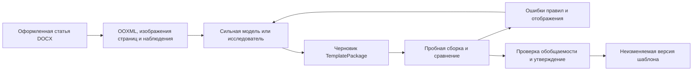

# Уточнённая концепция: дорогой шаблон, дешёвое применение

Версия 0.2. Основание — уточнение владельца продукта: сначала исследовать применение подготовленного шаблона небольшой моделью, затем автоматизировать универсальное извлечение; целевой продукт обрабатывает сотни DOCX и выдаёт ZIP.

## Что именно требуется

Оформленная статья DOCX служит примером желаемой вёрстки. Сильная модель, при необходимости с инструментами и обратной связью, помогает извлечь пригодный для повторного использования шаблон. В первой итерации шаблон можно составить вручную с помощью сильной модели и проверить редактором. Это разовая инвестиция на версию шаблона.

На каждую новую статью хочется тратить один вызов небольшой модели. Она должна определить роли блоков, выделения отдельных фрагментов, подписи и связи с изображениями и выдать машинное описание оформления. Код превращает описание и исходное содержимое в DOCX. Возможность более дорогого agent loop остаётся сравниваемым методом, а не скрытым продолжением неудачного one-pass.

Исследование ищет наиболее дешёвую и быструю конфигурацию, которая проходит заданные критерии. «Минимальная модель» означает минимум среди проверенных кандидатов при фиксированных протоколе входа, шаблоне, renderer и качестве; размер закрытых моделей обычно неизвестен.

## Отличия от v0.1

| Вопрос | Предыдущее решение | Уточнение v0.2 |
| --- | --- | --- |
| Первый этап | DOCX parser и извлечение шаблона | Подготовленный вручную/сильной моделью шаблон и исследование его применения |
| Ответ малой модели | В основном роли абзацев | DocumentPlan: роли, inline spans, object bindings, служебные labels |
| Один проход | Не был отдельным критерием | Строго измеряемый режим; repair, chunks и review учитываются отдельно |
| Качество | Сохранность + правила | Дополнительно восстановление образца, pixel comparison и перенос на новые статьи |
| Массовая обработка | Отложена | Основной пользовательский поток: сотни документов, очередь и ZIP |
| Универсальный считыватель | Научные DOCX как основной вход | Долгосрочная возможность разных типов документов; первая проверка на статьях |

Прежние инварианты сохранности, версии, доступ и программная сборка остаются. Полная генерация размеченного текста моделью включена в сравнение методов; пока не доказана её надёжность, это исследовательский вариант.

## Схема 1. Подготовка шаблона

Loop здесь допустим и его стоимость учитывается отдельно. Вначале человек может выполнить эти шаги без реализации универсального агента.

## Схема 2. Применение за один проход

«Модель создаёт DOCX» на уровне продукта означает этот путь. Модели не нужно печатать ZIP/base64 или повторно переписывать тысячи неизменных слов: она может сослаться на исходные блоки и диапазоны. Этот способ сравнивается с генерацией всего размеченного текста в [методах](../research/methods.md).

## Схема 3. Пакет статей

Ошибочная статья не блокирует оставшиеся. ZIP содержит только прошедшие проверки DOCX и реестр всех элементов, в том числе неуспешных; частичный результат помечается явно.

## Что проверяет эксперимент с исходным образцом

Восстановление статьи-образца десять раз — полезная первая ступень. Оно проверяет достаточность шаблона, интерпретацию правил и renderer, но само по себе не доказывает работу на новых текстах. Если в шаблон попали конкретный текст и позиции выделений исходной статьи, модель может воспроизвести экземпляр вместо применения правила.

Обычный текст необратимо теряет рисунки, некоторые границы объектов и произвольное авторское выделение. Одна и та же строка могла быть набрана целиком обычным шрифтом или с одним курсивным словом. Поэтому исследование отделяет text-only от текста с sidecar объектов и от входа с сохранённой семантической разметкой. Восстановление неизвестного выделения из text-only — гипотеза, а не гарантируемая функция.

Точный протокол и критерии — [план исследования](../research/study.md), [бенчмарк](../research/benchmark.md). Сейчас нет ни проведённых прогонов, ни выбранной минимальной модели.
