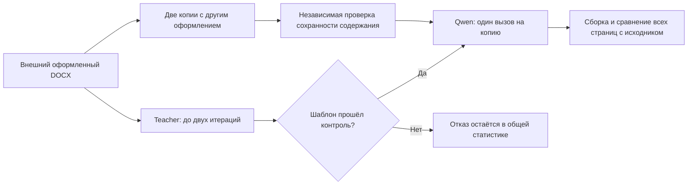

# Замороженная проверка на внешних DOCX: серия 027

17 октября 2026. Проверяем исходную систему **6f562abd94c2b59e07a17ec3054913a94e10a8b0**,
без изменения production-кода, prompts, схем ответов и правил компиляции.
**Итог: подтверждён 1 из 5 внешних шаблонов. Система не готова к произвольным DOCX.**
Предыдущие 4/4 новых синтетических текста не воспроизвелись как универсальная
надёжность на независимых источниках.

## Вопрос исследования и протокол

Задача этой серии — восстановление оформления **того же содержания**. Каждый
официальный DOCX служит единственным эталоном своего шаблона. Из его копии снимаем
оформление, затем отдельно создаём версию с Arial 14 pt, фиолетовым цветом,
другими отступами и межабзацными/межстрочными интервалами. Абзацы не переставляем.
Текст, табуляционные символы, содержимое формул, объектов и медиаданные сохраняем;
семантические выделения, границы секций и связи ресурсов остаются входом.



Teacher: `openai/gpt-6.1-sol`, reasoning low. Student: `qwen/qwen3.8-27b`, reasoning
none. Максимум две teacher-итерации с предусмотренной кодом обратной связью;
без человеческих подсказок и resume. После успешного извлечения — по одному
независимому student-вызову для каждой копии, без repair и повторов.

`experiment_real027.py` проверяет побайтовое совпадение всех tracked файлов
`src/articleflow` с замороженным commit перед каждым документом и после серии.
[Protocol](../../datasets/real-v027/protocol.json) создан до модельных прогонов;
[freeze](../../datasets/real-v027/freeze.json) содержит hashes реализации и manifest.
Изменения касались только нового evaluator, загрузчика и документации.

## Датасет и происхождение

Это **официальные образцы оформления**, опубликованные организаторами, а не
пять завершённых исследовательских статей. Они включают учебный/инструктивный
текст и placeholders. Материалы не создавались нашим синтетическим генератором.

| ID | Официальный источник | Страниц в нашем рендерере | Особенности |
|---|---|---:|---|
| herzen | [ФССО / РГПУ им. Герцена](https://psme.herzen.spb.ru/?page_id=49) | 3 | Два языка, OMML, ссылки, 184 узла proofErr |
| tusur | [Экономическая безопасность / ТУСУР](https://confes.fb.tusur.ru/node/8) | 2 | Требования и пример, ссылки, 20 узлов proofErr |
| bmstu | [Теория и реализация информационных систем / МГТУ](https://tiris.bmstu.ru/for-participants) | 5 | Двуязычные метаданные, пример статьи, разные свойства абзацев |
| acm | [ACM CHI 2020](https://chi2020.acm.org/authors/chi-proceedings-format/) | 5 | Две таблицы, четыре секции, floating anchor, сложные поля |
| osu | [Энергетика: состояние, проблемы, перспективы / ОГУ](https://konf.osu.ru/iees_energy/infoletter/requirements.html) | 1 | Короткий пример с заголовком, авторами, организацией и библиографией |

Всего 5 документов, 16 исходных страниц, 321 body-абзац. Созданы 8 вариантов
оформления для четырёх документов. ACM отклонён загрузчиком до преобразования;
его два плановых сценария остаются заблокированными, а не исключаются из знаменателя.
Все восемь созданных вариантов прошли исправленный content guard и визуально
отличались от оригиналов. Например, МГТУ: 5 страниц → 3 после нейтрализации и
7 после restyle; Герцен: 3 → 3 и 7. Это не тождественное копирование файла.

Ссылки на скачивание, размеры, SHA-256 и отказы загрузки записаны в
[sources.json](../../datasets/real-v027/sources.json). IEEE endpoint вернул не DOCX.
Для ОГУ первоначальный 404 вызван неверным разрешением относительного URL:
учтён HTML base, после чего получен оригинальный DOCX. Эти события сохранены.
ITMO давал RTF и не включён в native-DOCX выборку. Документы не отбирались по
успешности извлечения шаблона.

## Результаты без исключения неудобных случаев

| Источник | Результат | Где остановилось |
|---|---|---|
| Герцен | Не прошёл | `CATALOGUE_INLINE_UNSUPPORTED`: первый неподдерживаемый дочерний узел абзаца — `w:proofErr` |
| ТУСУР | Не прошёл | Та же проблема со служебной разметкой проверки орфографии |
| МГТУ | Не прошёл | Итерация 1: 3 конфликтные группы, 16 unresolved назначений у student; итерация 2: `QUESTION_SCHEMA` |
| ACM CHI | Не прошёл | `UNSUPPORTED_CONSTRUCT`: floating anchor; в файле также есть сложные поля |
| ОГУ | Прошёл | Один teacher-цикл, контрольный student и обе отдельные копии совпали полностью |

У МГТУ не сетевая ошибка: teacher вернул JSON с вопросами, два из которых
ссылаются на роли, отсутствующие в его же словаре ролей. Валидатор корректно
отклонил ответ. Первая итерация имела различия paragraph properties, в том числе
отступов/интервалов/стилей. Их нельзя объявить эквивалентными без отдельной проверки.

Для ОГУ оба итоговых документа имеют одну страницу, `pixel_exact=true`, долю
отличающихся пикселей 0. Все пять runtime integrity-проверок истинны. До сборки
доли отличающихся пикселей были 0.0260854 и 0.0321837. Дополнительно осмотрены
растры оригинала, повреждённого документа и результата. Совпадение проверялось
при 144 dpi в одном окружении LibreOffice, а не между разными офисными пакетами.

Итого:

- Автоматически подтверждённые шаблоны: **1/5**.
- Успешные самостоятельные восстановления: **2 из 10 плановых сценариев**;
  6 заблокированы неподтверждённым шаблоном, 2 — неподдержанным импортом.
- Среди фактически допущенных финальных student-применений: **2/2**. Этот условный
  показатель не заменяет общий результат 2/10.
- Реальных запросов: **7** — 3 teacher, 4 student, включая невалидный ответ teacher.
- Фактическая стоимость серии по provider metadata: **$0.153923225**.
- Production-код не изменялся; неудачные шаблоны не утверждались вручную.

Полная публичная машинная сводка: [results.json](../../datasets/real-v027/results.json).

## Ошибка измерительного инструмента

В первой версии нового content guard узлы `w:tab` внутри `pPr/tabs` ошибочно
считались содержимым. Это tab stops — свойства оформления, в отличие от `w:tab`
внутри run, который действительно является символом. Ошибка затронула подготовку
ТУСУРа и ОГУ **до их первого API-вызова**. Изменён только evaluator; добавлен тест,
проверяющий игнорирование tab stops и обнаружение удаления настоящей табуляции.
Для этих двух источников подготовка повторена и затем выполнен первый продуктовый
прогон. История начальных отказов и hashes обеих версий evaluator сохранены.
Эти ложные отказы инструмента не приписаны продукту и не скрывают платные попытки.

## Выводы и следующие изменения, ещё не внесённые

1. Нужна явная обработка служебных OOXML-аннотаций, начиная с proofErr: разрешённая
   нормализация с журналом отброшенных несемантических меток и проверкой содержания.
2. Teacher protocol должен предотвращать ссылки вопросов на неизвестные роли;
   возможный repair следует учитывать как дополнительный вызов, а не one-pass.
3. Конфликты точных свойств требуют диагностики: отличать реальный смысловой
   вариант оформления от технически разных, но визуально эквивалентных записей.
   Пока различия сохраняются, как запросил пользователь.
4. Плавающие объекты и сложные поля требуют отдельного расширения renderer/импорта.

Текущая версия подходит для ограниченного контролируемого пилота, но не для
массовой автоматической обработки произвольных DOCX. Следующую реализацию надо
проверять отдельной серией на этом regression-наборе и на новых внешних источниках.
После раскрытия ошибок набор 027 становится development/regression, его нельзя
повторно выдавать за нетронутый независимый test set.

## Воспроизводимость и хранение

В Git находятся исходники evaluator/загрузчика, протокол, manifest, hashes,
структурная опись и агрегированные результаты. Third-party DOCX, PDF, сырые
запросы/ответы и визуальные previews остаются **только локально** в ignored artifacts.
Независимое закрытое хранилище не подключено. Ссылки и hashes позволяют скачать
исходники заново только пока сайт отдаёт те же байты; они не заменяют backup.

```bash
.venv/bin/python scripts/download_real027.py --output artifacts/real027-inputs
FONTCONFIG_FILE=/path/to/fonts.conf .venv/bin/python scripts/experiment_real027.py \
  --sources datasets/real-v027/sources.json --inputs artifacts/real027-inputs \
  --output artifacts/real027-new --live --key-file /private/key --ledger /private/ledger.json
```

Без `--live` создаются только изменённые копии и измеряются отличия от исходников.
Нужен существующий единый ledger: скрипт его не создаёт и не обнуляет.
Новые ответы модели могут отличаться; URL с изменившимися байтами отклоняется
по SHA-256. Тест изменения evaluator и вся unit-suite проверены отдельно.
