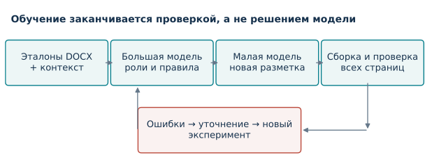
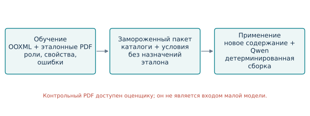
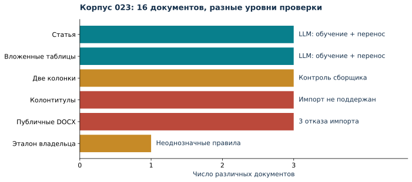
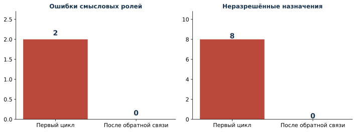
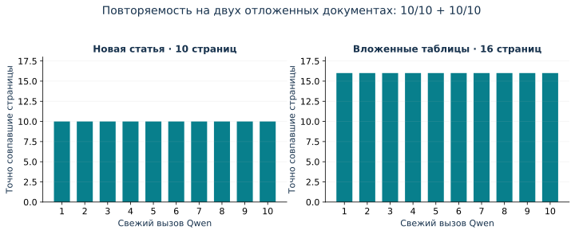
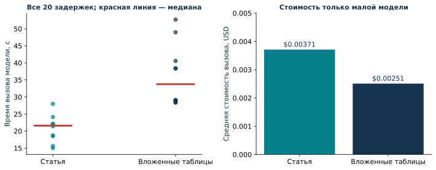
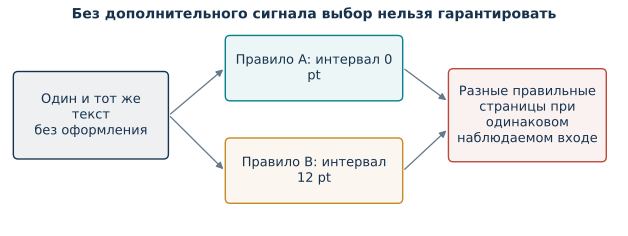

# ArticleFlow: агентное извлечение шаблонов DOCX с проверяемым переносом оформления

**Исследовательская рукопись. Серия 023, 17 октября 2026 года.** Авторство и сведения об организации должны быть заполнены владельцем перед подачей в журнал. Представленные результаты относятся к зафиксированным экспериментам, а не к универсальной гарантии для всех документов Word.

## Аннотация

**Проблема.** Автоматическое приведение научной статьи к образцу требует одновременно распознать смысловые блоки, сохранить содержание и воспроизвести точную геометрию документа. Правильное название шрифта или успешная разметка абзацев сами по себе не подтверждают правильность результата: могут измениться висячие отступы библиографии, интервалы после таблиц и границы страниц. **Метод.** Предлагается архитектура ArticleFlow, в которой большая языковая модель формирует определения ролей, детерминированный компилятор извлекает полные свойства Office Open XML, а малая модель применяет замороженный шаблон. Агентный цикл включает реальный вызов малой модели, повторную сборку документа, проверку неизменности содержания и попиксельное сравнение всех страниц. Неоднозначные правила не заменяются наиболее частым вариантом. **Эксперимент.** Подготовлены 12 собственных синтетических документов четырёх семейств, получены три публичных DOCX и использован один разрешённый частный эталон. Qwen3.8-27B выполнила две серии по десять свежих вызовов на двух отложенных синтетических документах объёмом 10 и 16 страниц. Все 20 результатов совпали с соответствующими контрольными PDF; стоимость этих вызовов составила 0,06221447 USD. Обратная связь исправила две ошибки смысловой разметки документа с вложенными таблицами. **Ограничения.** Все три публичных образца встретили ограничения импорта, а частный эталон остался неоднозначным. Результаты подтверждают работоспособность ограниченного контура, но не универсальный перенос. **Практическая значимость.** Метод делает критические ошибки оформления измеримыми и препятствует выдаче непроверенного шаблона как готового.

**Ключевые слова:** DOCX; извлечение шаблонов; большие языковые модели; Qwen; агентный цикл; визуальная проверка; сохранность содержания; воспроизводимость.

## 1. Постановка задачи

Подготовка научных рукописей к публикации часто выполняется по образцу Word. Пользователь располагает одной или несколькими правильно оформленными статьями и ожидает, что система перенесёт правила на новый текст. Однако образец содержит одновременно правила издания, содержание конкретной статьи и случайные особенности редактирования. Например, пустой абзац между таблицей и текстом может быть осознанным интервалом либо результатом ручной правки. Единственный пример не всегда позволяет различить эти причины.

Цель исследования — построить проверяемый программный процесс извлечения и применения шаблонов. При создании шаблона допускается более дорогая модель и несколько экспериментов. Последующее применение должно обходиться одним вызовом меньшей модели и детерминированной сборкой. Модель не получает права изменять научный текст, числа, ссылки, фамилии или формулы. Её задача — выбрать смысловые роли существующих фрагментов. Свойства оформления задаются программно проверенным пакетом.

В исследовании рассматриваются три вопроса. Во-первых, может ли обратная связь от реального применения малой модели улучшить извлечённый шаблон? Во-вторых, воспроизводит ли замороженный пакет новый текст того же семейства без исходного оформления? В-третьих, обнаруживает ли система случаи, в которых точного результата достичь не удалось? Последний вопрос принципиален: ложный статус готовности переносит скрытые ошибки в дальнейшую массовую обработку.

Под «точностью» далее понимается проверяемое равенство в фиксированной среде визуализации. Для нового текста ожидаемое число страниц может отличаться от числа страниц обучающего образца. Поэтому перенос оценивается по независимому контрольному документу с тем же новым содержанием и правильным оформлением. Сравнение новой статьи с PDF старой статьи не является корректной метрикой оформления.

## 2. Связанные работы и предмет исследования

Office Open XML задаёт устройство документов, отношений и свойств оформления [1]. Это позволяет извлекать значительную часть геометрии непосредственно из файла, а не оценивать интервалы по изображению. Вместе с тем итоговая страница зависит от наследования стилей, таблиц, полей, шрифтов и поведения конкретного движка отображения. Поэтому программное чтение свойств и визуальное сравнение решают разные части задачи.

Работы по анализу макета документа обычно распознают области страницы и их классы. DocLayNet подчёркивает значение разнообразия источников при оценке моделей анализа макета [2]. Для ArticleFlow этот вывод важен методологически: точный результат на нескольких сходных синтетических статьях нельзя переносить на весь набор офисных документов. При этом распознавание области «таблица» ещё не определяет все свойства вложенных ячеек или интервал после таблицы.

DSPy рассматривает оптимизацию программ, содержащих языковые модели, относительно заданной метрики [3]. В настоящей работе сходная идея применяется к циклу формирования шаблона, но выход ограничен определениями ролей и декларативными правилами. Модель не генерирует исполняемый код. Исследования структурированного декодирования показывают пользу формального ограничения пространства ответов [4]. Однако синтаксически допустимый ответ может оставаться семантически неверным; поэтому проверка JSON не заменяет проверку документа.

Предлагаемый вклад — сочетание раздельных контуров обучения и применения, полного каталога свойств, отказа при неоднозначности, проверки всех страниц и независимого контроля содержания. Новая нейросетевая архитектура или обучение весов в этой работе не предлагаются. Сравнение с коммерческими системами форматирования и доказательство превосходства над ними не проводились.

## 3. Представление шаблона и разделение информации

### 3.1. Содержание, роли и свойства

Документ представляется последовательностью абзацев, таблиц, строк, ячеек и непрозрачных научных объектов. Текст сохраняется отдельно от каталога оформления. Каталог включает свойства абзацев, фрагментов текста, таблиц, строк, ячеек, секции и встроенных рисунков. Формулы и связи объектов сохраняются как защищённые данные. Такой подход позволяет заново собрать основное содержимое DOCX, не копируя готовую статью в качестве результата.

Большая модель получает наблюдения эталона и предлагает смысловые роли: заголовок, основной текст, подпись таблицы, ячейка заголовка, библиографическая запись и другие. Для каждого существующего абзаца она возвращает роль через ограниченный список непрерывных диапазонов. Компилятор проверяет полное покрытие: абзац нельзя пропустить, назначить дважды или заменить новым текстом. Малая модель использует ту же схему ответа.

Условия выбора оформления опираются на роль, соседние роли, тип соседнего объекта, глубину таблицы, число столбцов, положение столбца и полосу строки. Семантические выделения, индексы и языковые метки входного DOCX объявлены дополнительным входом. Шрифты, размеры и интервалы исходной статьи малой модели не передаются. Таким образом, эксперимент относится к структурированному DOCX с сохранённой семантикой, а не к восстановлению всей информации из чистого текста.

### 3.2. Запрет скрытого запоминания

Runtime-пакет содержит каталог свойств и условия их выбора, но не содержит назначения каждого абзаца эталона. В условиях запрещены идентификаторы исходных блоков, номер абзаца, текстовая цитата и hash текста. Это исключает прямую реализацию правила «для абзаца 98 взять стиль X». Определения ролей остаются естественно-языковыми и поэтому требуют отдельной проверки на новых документах: отсутствие позиционного правила само по себе не доказывает обобщение.

Для каждого сочетания признаков компилятор требует согласия наблюдений. Если одинаковый контекст связан с разными свойствами, фиксируется конфликт. Большая модель может уточнить смысловые роли и повторить эксперимент. При исчерпании лимитов шаблон остаётся неготовым. Самый частый вариант не выбирается автоматически, поскольку редкий вариант может быть обязательным исключением, а не шумом.

### 3.3. Интервалы и пустые абзацы

Видимый промежуток между объектами может определяться интервалом до или после абзаца, высотой пустого абзаца, межстрочным интервалом и свойствами знака абзаца. Поэтому один параметр «отступ» недостаточен. В реализации сохраняются полные свойства, а последовательности пустых абзацев верхнего уровня изучаются отдельно как переходы между соседними смысловыми объектами.

При нейтрализации обучающего документа пустые абзацы оформления удаляются. При восстановлении они могут быть добавлены по правилу перехода, например «таблица → основной текст». Учитывается также отсутствие промежутка: если один и тот же переход встречается с разными промежутками, правило признаётся неоднозначным. Вставленные пустые абзацы учитываются отдельно при проверке сохранности, чтобы служебное восстановление интервала не маскировало изменение научного содержания.

## 4. Агентный цикл и критерий приёмки

Одна итерация включает извлечение наблюдений, предложение большой модели, компиляцию правил, создание реально испорченного по оформлению DOCX, вызов Qwen, сборку и сравнение. В следующую итерацию передаются ошибки разметки, противоречивые свойства и результаты проверок. Реализована возможность приложить изображения первой различающейся страницы; количественная проверка при этом всегда охватывает все страницы. Отдельная эффективность визуального входа большой модели в данной серии не измерялась.

Пусть R(D) обозначает растровые страницы документа D при фиксированных движке, шрифтах, разрешении 144 DPI и пространстве RGB. Успех реконструкции задаётся совместным выполнением условий: неизменность научного содержания и связей; совпадение числа и размеров страниц; равенство каждого пикселя соответствующих страниц. Для каждой страницы вычисляется число различающихся пикселей. Ненулевое значение означает неуспех даже при очень малой средней ошибке.

Нулевой порог полезен для проверки реконструкции одного и того же содержания в одной среде. Он не означает, что разные версии Word и LibreOffice дадут одинаковое изображение. Для переносимости между движками требуется отдельный протокол. Кроме того, одинаковая картинка не доказывает правильность скрытых ссылок, формул или порядка объектов, поэтому визуальная и структурная проверки применяются совместно.

Проверяющий модуль испытывается намеренно внесёнными дефектами: заменой шрифта, изменением геометрии страницы, удалением интервала после таблицы и изменением текста. Содержание проверяется независимо от изображения. Успешное восстановление эталона без успешных отрицательных контролей не позволяет утвердить шаблон.

Цикл ограничен числом итераций, временем и бюджетом. В текущем срезе принимаются до десяти эталонов, до 2000 абзацев и до пяти итераций. Проверка изображений ограничена ста страницами. Эти ограничения — свойства реализации, а не утверждение о предельной сложности метода. Превышение ограничения или неподдерживаемая конструкция дают явную остановку.

## 5. Корпус и протокол эксперимента

### 5.1. Состав документов

Синтетический корпус создан специально для проверки полного пути: от DOCX до восстановленного DOCX и PDF. Он содержит 12 файлов, всего 2131 абзац. Для каждого из четырёх семейств подготовлены два обучающих варианта и один отложенный вариант с другим текстом и числовыми значениями. Вложенный случай включает длинную таблицу из 34 строк, повторяемую шапку, вложенную таблицу 3 × 2 и различные интервалы. Библиографические записи проверяют висячий отступ; двухколоночное семейство — геометрию секции.

| Часть корпуса | Документов | Назначение и фактический уровень проверки |
|---|---:|---|
| Синтетическая статья | 3 | Обучение и 10 свежих вызовов на одном новом документе |
| Вложенные таблицы | 3 | Два обучающих эталона, обратная связь, 10 вызовов на новом документе |
| Две колонки | 3 | Детерминированная проверка сборщика на одном варианте; не серия LLM |
| Колонтитулы | 3 | Случаи за пределами текущего импортера |
| Публичные Word-шаблоны | 3 | Проверка доступности и импорта; все три отклонены |
| Частный эталон владельца | 1 | 12 страниц, реальное обучение; шаблон не подтверждён |

Собственные тексты синтетические и не являются научными результатами по предметным темам, упоминаемым внутри них. Исходники генератора публикуются. Начальное значение генератора фиксирует содержание, но ZIP-метаданные времени не заморожены; идентичность файлов конкретной серии подтверждается SHA-256. Метки правильных ролей используются только в отдельно обозначенном контроле сборщика, а не выдаются за ответ модели.

Публичные документы получены со страниц Мурманского университета, проекта Gostdown и экономического журнала Воронежского университета [5–7]. Сам факт нахождения файла в интернете не трактуется как разрешение на его повторную публикацию. В открытом отчёте сохранены адреса, hashes и коды ограничений; байты документов и извлечённые тексты остаются вне публичного репозитория. Неудачная загрузка A4-шаблона IEEE дала пустой файл и не включена в число документов.

### 5.2. Разделение обучения и переноса

Большая модель — openai/gpt-6.1-sol; малая — qwen/qwen3.8-27b, доступная через OpenRouter [8, 9]. Для Qwen использован режим без дополнительного reasoning. Выпуск выбранной версии Qwen подтверждён первичным источником; локальное размещение её весов в этой работе не испытывалось. Название «малая» обозначает её роль относительно модели обучения, а не обещание работы на любом персональном компьютере.

Перед каждой серией пакет шаблона фиксировался. Контрольный вариант с seed 17 не включался в обратную связь обучения. Его оформление нейтрализовалось, а содержание, структура таблиц, научные объекты и объявленные семантические выделения сохранялись. Каждый из десяти вызовов был отдельным обращением к провайдеру. Неудачные первые циклы, исправления параметров запуска и продолжения после бюджетной остановки учитывались отдельно.

Повторные вызовы одного документа оценивают повторяемость модели при фиксированном входе. Они не превращают один документ в десять независимых примеров. Две серии ниже относятся ровно к двум отложенным документам из двух знакомых семейств генератора. Перенос на независимые рукописи другого происхождения этим не установлен.

## 6. Результаты

### 6.1. Исправление через обратную связь

Первый цикл для двух эталонов с вложенными таблицами дал 234 правильных назначения из 236 в одном документе и 244 из 244 во втором. Две ошибки первого документа привели к восьми неразрешённым назначениям оформления. Проверка не допустила шаблон. После передачи ошибок и уточнения ролей следующий зафиксированный цикл дал 236/236 и 244/244; оба документа совпали с эталонами по всем страницам.

Этот случай демонстрирует работающую петлю «предложение → измерение → уточнение». Он не доказывает, что каждый конфликт разрешим такой петлёй. Между циклами происходила явная бюджетная остановка; продолжение сохранено как отдельный запуск. В статистике исходная неудача остаётся неудачей, а не заменяется последней удачной попыткой.

### 6.2. Применение замороженных шаблонов

| Серия | Новых документов | Свежих вызовов | Точных результатов | Страниц в одном результате | Стоимость серии, USD |
|---|---:|---:|---:|---:|---:|
| Статья | 1 | 10 | 10 | 10 | 0,03712713 |
| Вложенные таблицы | 1 | 10 | 10 | 16 | 0,02508734 |
| Всего | 2 | 20 | 20 | 260 проверенных страниц во всех повторах | 0,06221447 |

Во всех двадцати попытках совпали содержание, размещение защищённых объектов и растровое представление страниц. В более поздней реализации отдельно усилен контроль вложенной топологии таблиц; историческая серия статьи предшествовала этой дополнительной метрике. Отсутствующая метрика не заполняется задним числом. Повторное применение сохранённых ответов к обновлённому коду фиксируется как offline replay, а не как новый вызов модели.

Средняя стоимость вызова Qwen составила около 0,00371 USD для статьи и 0,00251 USD для вложенного случая. Меньшая стоимость более длинного документа в этой серии не означает общего закона: счёт зависит от состава запросов, ответа и условий провайдера, включая кэширование. Задержки включают сетевой вызов; они не являются измерением скорости локального инференса. Большая модель и локальная визуализация в эти средние стоимости не входят.

### 6.3. Отрицательные результаты

Зафиксированная основная серия содержит 35 обращений к провайдеру, из них 34 с полученными валидными ответами и одно с HTTP 400. Сумма известных списаний — 0,753724935 USD; она не включает неопределённый расход ошибочного запроса. Ошибка возникла из-за несовместимого режима reasoning большой модели. После изменения настройки начата другая серия. Предварительные остановки по бюджету происходили до отправки запроса и не считаются вызовами модели.

Реальный частный эталон показал более трудную проблему. В позднем свежем вызове малая модель правильно назначила все 161 сохранившихся после удаления пустых абзацев блока, однако компилятор обнаружил 46 противоречивых групп и 335 неразрешённых назначений. Значит, правильная смысловая классификация не обеспечивает однозначного выбора свойств. После развития признаков и правил промежутков повтор сохранённого ответа уменьшил число неразрешённых назначений до 255; число конфликтных групп изменилось до 47 вследствие более подробного разбиения. Это не новый результат LLM и не успешная реконструкция.

Отдельно проверена гипотеза, что различия внутренних стилей можно безопасно устранить раскрытием наследуемых свойств. Число страниц осталось равным двенадцати, но доля различающихся пикселей составила 0,0002320119, то есть около 0,0232%. Кандидат отклонён. Малое среднее расхождение не использовано как основание для замены строгого критерия.

| Случай | Результат | Что он показывает |
|---|---|---|
| Частный эталон | needs_review | Роли могут быть верны, а типографические правила — неоднозначны |
| Мурманский публичный шаблон | Неподдерживаемая конструкция | Существуют конструкции за пределами текущего импортера |
| Gostdown | Колонтитулы не поддержаны | Колонтитулы требуют отдельного представления |
| Воронежский публичный шаблон | Активное содержимое | Активное/встроенное содержимое не удаляется ради успешной обработки |
| Нормализация внутренних стилей | 12 страниц, pixel exact = false | Равная пагинация недостаточна для доказательства равенства |

Таким образом, общая оценка «20/20» не должна включать все документы корпуса в знаменатель. Это результат конкретного теста повторяемости. Для универсального извлечения публичные и реальные документы показывают незакрытые ограничения.

## 7. Человеческая обратная связь и неоднозначность

Наблюдение «ключевые слова присутствуют в образце» совместимо как с обязательностью блока, так и с его факультативностью. Система не может логически вывести нормативное требование из единственного положительного примера. Дополнительные эталоны с разным составом помогают, но не всегда разрешают вопрос. Поэтому пользователь может дополнить образцы требованиями, а интерфейс поддерживает отдельное подтверждение обязательности ролей.

Вопрос сопровождается фрагментом эталона и ссылкой на его PDF; если текст найден при разборе PDF, ссылка открывает соответствующую страницу. Решение пользователя создаёт новую версию требований. Оно не исправляет научный текст и не отменяет визуальную проверку. Если в новой статье отсутствует наблюдавшийся блок, отсутствие которого ещё не разрешено, результат остаётся черновиком с вопросом. Так предотвращается прежняя ситуация, когда пропуск ключевых слов оставался незамеченным.

Есть и более фундаментальная неоднозначность. Пусть два допустимых эталона после удаления оформления дают один и тот же вход X, но требуют разных изображений Y₁ и Y₂. Любой детерминированный алгоритм f(X) выдаёт один результат и поэтому не может одновременно гарантировать f(X) = Y₁ и f(X) = Y₂. Случайный выбор также не обеспечивает стопроцентной гарантии. Следовательно, требование восстановить любой документ из чистого текста без дополнительных сигналов в общем случае невыполнимо.

Практическое следствие — явно определять допустимые входные сигналы и класс шаблонов. В текущем протоколе сохраняется структура и семантическое выделение, неоднозначности не скрываются, а решение может быть получено из дополнительного образца или ответа человека. Это ограничение информации, а не аргумент против автоматизации большинства однозначных случаев.

## 8. Воспроизводимость, эксплуатация и бюджет

Каждый запуск сохраняет конфигурацию, запрос, ответ, проверенный план, результаты сборки, изображения различий и hashes. Первичные частные материалы отделены от публичных исходников и обезличенных метрик. Пакет шаблона имеет контрольные суммы; утверждение проверяет, что эталоны и пакет не изменились после измерения. Версии требований и шаблона неизменяемы, что позволяет объяснить, каким именно набором правил обработана статья.

Списание и резервирование учитываются в едином журнале. Перед запросом проверяются фактический остаток провайдера, объявленный лимит и консервативная оценка максимального расхода. Ошибка HTTP не означает нулевой расход: неопределённый резерв сохраняется до подтверждения. Изменение лимита с 3 до 4 USD записано отдельно; исходный checkpoint и прежние расходы не сброшены. Успех эксперимента не определяется количеством потраченных денег.

Обычные автоматические тесты не обращаются к платным моделям. Для них используются синтетические документы и явно обозначенные сохранённые ответы. Интеграционные серии запускаются отдельно. Полный первичный снимок основной серии содержит 1015 файлов, проверенных SHA-256 на сервере и на компьютере владельца. Копирование архива и повторная проверка hashes предотвращают смешение описания выполненной работы с наличием её фактических результатов.

Веб-приложение предоставляет обучение, историю итераций, просмотр эталона и результата, утверждение проверенной версии, вопросы об обязательных блоках и пакетную обработку. Статус reference_verified означает проверку обучающих эталонов. Он не равнозначен доказанному качеству на любом новом документе. Для поступившего текста дополнительно проверяются содержание, обязательные блоки, шрифты и физические дефекты; готовые файлы и черновики различаются в пакетном экспорте.

## 9. Ограничения и угрозы валидности

Главное ограничение — небольшой объём независимого переноса. Использованы два отложенных документа из тех же семейств, по которым создавались шаблоны. Их тексты изменены, но структура предсказуема. Повторяемость 10/10 не даёт оценки разнообразия реальных журналов. Для внешней валидности нужен заранее закрытый корпус разных издательств, авторов и редакторов, включающий успешные и неподдержанные документы без последующего исключения неудобных случаев.

Текущий компилятор поддерживает одну секцию, обычные и вложенные таблицы, колонки, inline-рисунки и OMML в пределах импортера. Колонтитулы, сложные поля, несколько секций, плавающие объекты и embedded OLE не проходят полный контракт. Ресурсы нескольких эталонов должны совпадать; автоматическое согласование разных таблиц стилей ещё не реализовано. Ограничение не снимается наличием большой модели: исполнитель должен уметь безопасно представить предлагаемые операции.

Семантические выделения и языковые метки являются дополнительной информацией. Полученные результаты нельзя переносить на строгий режим «только текст». Допускается, что часть типографических исключений в частном образце случайна, но исследование не удаляет их без согласования. Строгий критерий может быть избыточен для задач, где допустимы небольшие визуальные различия; такой режим должен иметь отдельные метрики и не называться попиксельным совпадением.

Версия модели предоставляется внешним сервисом. Точные веса, вычислительное оборудование и политика кэширования провайдера не контролируются исследователем. Поэтому измеренные цена и задержка описывают данную серию OpenRouter, а не стоимость локального развёртывания. Не проведены сравнение нескольких малых моделей, обучение весов, слепая экспертная оценка оформления и измерение эффективности визуальных подсказок большой модели.

## 10. Заключение

Реализован и испытан ограниченный агентный контур извлечения шаблонов DOCX. Его существенное свойство — возможность проверять собственные предложения реальным вызовом малой модели и завершать работу только после измеримой проверки. На сложном синтетическом примере обратная связь исправила ошибки разметки; два замороженных шаблона дали двадцать точных результатов на двух отложенных документах. Проверки учитывали все 260 страниц результатов, а не только заголовки или отдельные интервалы.

Одновременно эксперимент выявил разрыв между успешной реконструкцией поддерживаемого класса и универсальным извлечением шаблонов. Реальный эталон остался неоднозначным, три публичных образца не прошли импорт. Поэтому обоснованный результат работы — проверяемый механизм с измеренными успехами и явными отказами. Следующий этап должен расширить представление сложных конструкций и независимый корпус, сохраняя запрет ложного допуска. Такая постановка позволяет развивать качество системы без подмены доказательств внешне убедительными документами.

## Список литературы

1. Ecma International. ECMA-376: Office Open XML file formats. URL: https://ecma-international.org/publications-and-standards/standards/ecma-376/ (дата обращения: 17.10.2026).

2. Pfitzmann B., Auer C., Dolfi M., Nassar A. S., Staar P. W. J. DocLayNet: A Large Human-Annotated Dataset for Document-Layout Analysis. 2022. DOI: 10.1145/3534678.3539043. URL: https://arxiv.org/abs/2206.01062.

3. Khattab O., Singhvi A., Maheshwari P. et al. DSPy: Compiling Declarative Language Model Calls into Self-Improving Pipelines. 2023. arXiv:2310.03714. URL: https://arxiv.org/abs/2310.03714.

4. Geng S., Josifoski M., Peyrard M., West R. Grammar-Constrained Decoding for Structured NLP Tasks without Finetuning. Proceedings of EMNLP. 2023. P. 10932–10952. DOI: 10.18653/v1/2023.emnlp-main.674. URL: https://aclanthology.org/2023.emnlp-main.674/.

5. Вестник Мурманского университета. Требования к оформлению и шаблон статьи. URL: https://vestnik.mauniver.ru/conditions/typography.shtml (дата обращения: 17.10.2026).

6. ИПА РАН. Gostdown: шаблон отчёта demo-template-report.docx. URL: https://gitlab.iaaras.ru/iaaras/gostdown (дата обращения: 17.10.2026).

7. Вестник Воронежского государственного университета. Серия: Экономика и управление. Условия подачи и шаблон статьи. URL: https://journals.vsu.ru/econ/ru/about/submissions (дата обращения: 17.10.2026).

8. Qwen Team. Qwen3.8: repository and release information. URL: https://github.com/QwenLM/Qwen3.8 (дата обращения: 17.10.2026).

9. OpenRouter. Qwen3.8 27B. URL: https://openrouter.ai/qwen/qwen3.8-27b (дата обращения: 17.10.2026).

10. ArticleFlow. Исходники, протокол и обезличенные результаты серии 023. Ветка codex/web017-recovery. URL: https://github.com/timuroid/articleflow/tree/codex/web017-recovery. Машинная сводка: docs/research/evaluation-023.json; исходник рукописи: docs/research/manuscript-023.md.
