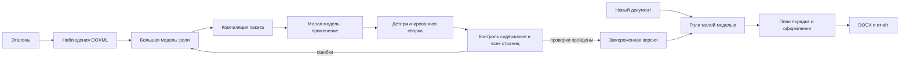

# ArticleFlow: извлечение переносимых правил структуры и оформления документов DOCX

Рабочая исследовательская рукопись 024. Сведения об авторах заполняются перед
публикацией. Модельные результаты относятся к серии 023; проверки расширений
компилятора и интерфейса — к серии 024. Универсальный перенос пока не доказан.

## Аннотация

**Проблема.** Приведение документа Word к образцу требует распознать смысловые
блоки, сохранить содержание, воспроизвести оформление и исправить порядок
разделов. Копирование текста в существующий файл не отделяет правила шаблона
от случайных особенностей образца. **Метод.** Предложен программный конвейер,
в котором большая языковая модель формулирует переносимые определения ролей,
детерминированный компилятор сохраняет полные свойства Office Open XML, а меньшая
модель назначает роли содержимому нового документа. Цикл извлечения включает
реальное применение, контроль содержания и сравнение всех страниц. Шаблон
содержит условия выбора оформления и отношения порядка, но не текст эталона.
**Эксперимент.** В опубликованной синтетической серии 023 два отложенных документа
прошли по десять свежих применений Qwen3.8-27B с точным совпадением контрольных
PDF. В серии 024 проверены три новых текста и все 24 перестановки четырёх
смысловых групп каждого текста: 72 случая восстановлены точно при известных
ролях. **Ограничения.** Повторы двух документов не заменяют независимый корпус;
известные роли не являются предсказанием модели. Перенос на произвольные реальные
DOCX и работу существенно меньших локальных моделей предстоит проверить.
**Практическая значимость.** Архитектура разделяет стоимость создания шаблона
и массового применения, делает ошибки наблюдаемыми и блокирует результат
при непроверяемой потере содержания или неоднозначном правиле.

Ключевые слова: DOCX; извлечение шаблонов; языковые модели; агентные системы;
перенос структуры; компилятор документов; визуальная проверка.

## 1. Постановка задачи

Документы организаций часто оформляются по одному или нескольким образцам.
Научные статьи — содержательный частный случай: в них встречаются аннотации,
сведения об авторах, ссылки, формулы, изображения, подписи и вложенные таблицы.
Задача системы шире подготовки статей: извлечь переносимые правила из DOCX
и применить их к документу с иным содержанием.

Пусть R — набор эталонов, X — новое содержание, T — извлечённый пакет правил,
а Y — итоговый документ. Требуется построить T=Extract(R), затем Y=Apply(T,X),
сохранив содержание X и удовлетворив подтверждённые правила T. Шаблон не должен
запоминать текст, номера абзацев или авторов R. Число страниц Y не обязано
совпадать с числом страниц эталона: оно зависит от нового содержания.

Образец содержит одновременно правила и случайные особенности редактирования.
Один документ не позволяет установить обязательность каждого встреченного
блока. Например, сведения о финансировании могут быть свойством конкретной
работы. Аналогично разные настройки двух однотипных абзацев могут отражать
семантическое различие либо ошибку оформления. Неидентифицируемость не должна
скрываться выбором наиболее частого значения.

Исследуются вопросы:

1. Улучшает ли обратная связь от реального применения малой модели шаблон,
   предложенный большой моделью?
2. Можно ли применять замороженный пакет к новому тексту без исходной типографики?
3. Какие ошибки обнаруживает программный контроль, даже если модель вернула
   синтаксически корректный ответ?
4. Как отделить точность классификации, сборки, порядка и визуального результата?

## 2. Связанные подходы и вклад

Office Open XML [1] позволяет читать свойства непосредственно из документа:
геометрию секции, отступы, интервалы, свойства символов, таблиц и рисунков.
Однако одинаковые явно записанные значения ещё не определяют итоговую страницу:
действуют наследование стилей, ресурсы шрифтов и правила движка отображения.
Поэтому извлечение XML дополняется визуальной проверкой.

Подходы ReAct [2] и Reflexion [3] рассматривают циклы действия и обратной связи
для языковых агентов. DSPy [4] и TextGrad [5] показывают способы оптимизации
программных систем и текстовых инструкций вокруг моделей. ArticleFlow относится
к этой области, но использует предметные проверки DOCX: сохранность объектов,
структуру таблиц, целостность текста и изображение всех страниц.

Передача между большой и меньшей моделью выполняется через внешний артефакт,
а не обновление весов. Это можно интерпретировать как передачу опыта в виде
инструкций и правил, но не как классическую дистилляцию модели [6]. Сам принцип
передачи инструкций не заявляется новым. Проверяемый вклад — разделение
семантического решения и точной сборки, контракт переносимого пакета, контроль
разрешённых перестановок и протокол оценки, различающий oracle и model trials.
Прямое количественное сравнение с перечисленными системами ещё не проведено.

## 3. Представления и архитектура

DOCX разбирается как пакет частей и отношений OPC. На входе проверяются размер,
состав и поддерживаемые конструкции. Неподдерживаемый объект не удаляется молча.
Документ разделяется на содержание, наблюдаемые свойства и контрольный план.

| Представление | Содержимое | Доступ при применении |
|---|---|---|
| Нейтральное содержание | Текст, дерево абзацев и таблиц, исходные научные объекты | Да |
| Каталог свойств | Полные варианты paragraph/run/table/section/drawing | Да, через пакет |
| Семантические правила | Роли и условия выбора вариантов | Да |
| Отношения порядка | Предшествование неповторяющихся ролей | Да |
| Исходные назначения | Соответствие абзацев эталона его вариантам оформления | Только контроль; не runtime |

Свойства не переводятся в округлённые числовые приближения. Пакет сохраняет
необходимые ресурсы и ссылки стилей. Но наличие каталога всех вариантов ещё
не означает наличие правила, позволяющего выбрать вариант для нового текста.
Эта разница является одним из основных источников ложных заявлений о точности.

Малая модель получает определения ролей и содержание. Она не генерирует весь
научный текст заново и не пишет произвольный XML. Её ограниченный ответ назначает
роли существующим блокам. Компилятор проверяет полное покрытие без перекрытий,
выбирает оформление и собирает новый документ. В текущем протоколе сохранены
объявленные семантические признаки DOCX, включая выделения и индексы; это не
восстановление всех сведений из чистого plain text.

## 4. Цикл извлечения и применения

Большая модель получает наблюдения эталонов и предлагает переносимые роли.
Нельзя определять роль номером абзаца, цитатой или идентичностью автора.
Компилятор объединяет свойства только там, где наблюдения дают однозначное
соответствие. Противоречия сохраняются с перечислением различающихся свойств.
Обнаруженная разница XML сама по себе не доказывает визуальную неэквивалентность,
но также не даёт права удалить её без проверки.

Для контрольного применения оформление эталона нейтрализуется. Малая модель
назначает роли очищенному документу, после чего сборщик восстанавливает DOCX.
Проверяются содержание, размещение объектов, вложенная топология таблиц,
защищённые индексы и все страницы PDF. Обратная связь содержит конфликты,
ошибки ролей и результаты сравнения. На следующей итерации большая модель
может изменить определения. Число итераций и расходы ограничиваются.

Проверка обнаружения ошибок использует отрицательные контроли: намеренно
нарушаются свойства или содержание. Сам по себе успешный ответ модели не
является основанием для утверждения шаблона. Проверенный на образцах пакет
фиксируется; контроль нового текста не должен обращаться к исходным назначениям.

### 4.1. Структурные перестановки

Расширение 024 хранит отношения предшествования смысловых ролей. Смежные абзацы
одной роли образуют группу. Роли, повторяющиеся несмежно, исключаются из
глобальной сортировки: все заголовки нельзя переносить перед всем основным
текстом. Несовместимые отношения нескольких эталонов и циклы блокируют пакет.

Исполнитель использует стабильную топологическую сортировку безопасных групп.
Перестановка должна быть биекцией: каждый исходный блок используется ровно один
раз. Для проверки строится исходный документ с этой разрешённой перестановкой;
с ним сравнивается результат. Контроль не заменяется подсчётом слов или
неупорядоченным множеством абзацев. Таблицы, объекты, потенциальные подписи,
нумерация и другие неподтверждённые связи пока ограничивают область перестановки.
Если выполнить правило безопасно нельзя, система сообщает об этом.

### 4.2. Автоматический и assisted-режимы

Основной режим не требует ответа на каждый вопрос, возникающий из одного
образца. Неизвестная обязательность блока остаётся неизвестной и отражается
в отчёте. Явно заданные обязательные роли проверяются отдельно. В assisted-режиме
пользователь подтверждает требования перед сохранением версии.

Уточнение во время работы читается перед следующей итерацией. В отчёте
различаются полученная и применённая версии. Если уточнение поступило слишком
поздно и не использовано, сохранение блокируется. Это предотвращает ошибочное
впечатление, что запоздалый ответ уже повлиял на результат. Интерфейс показывает
стадии извлечения, компиляции, применения, сравнения и отрицательных контролей.

## 5. Синтетический корпус и протокол

Корпус 023 создаётся опубликованным генератором. Четыре семейства включают
обычную статью, вложенные таблицы, колонки и колонтитулы. Для каждого семейства
созданы два обучающих варианта и один отложенный вариант: всего 12 документов
и 2131 абзац. Контрольные роли генератора не передаются модели как ответ.
Фактически успешный модельный перенос измерен только для article и nested.

В опубликованной серии использованы teacher openai/gpt-6.1-sol и student
qwen/qwen3.8-27b. Два отложенных документа имеют 10 и 16 страниц. Каждый
применялся десятью отдельными запросами. Нельзя трактовать эти двадцать повторов
как двадцать независимых рукописей. Данные происхождения моделей и настройки
серии фиксируются отдельно; локальные веса и квантизация здесь не испытывались.

Новый корпус 024 посвящён порядку. Обучающий seed 1 задаёт четыре роли;
seeds 3, 7 и 11 создают другой текст. Для каждого нового текста оформление
нейтрализуется и перебираются все 24 перестановки блоков. Роли предоставляет
генератор. Это изолированная проверка компилятора, не испытание LLM.

## 6. Результаты

| Проверка | Результат | Что измерено |
|---|---:|---|
| Модельный перенос article, 023 | 10/10 exact | Повторы одного нового документа |
| Модельный перенос nested, 023 | 10/10 exact | Повторы второго нового документа |
| Перестановки и оформление, 024 | 72/72 exact | Три новых синтетических текста, известные роли |
| Unit-проверки после расширений | 135 успешно | Программные инварианты и оркестрация |
| Исходные BDD-серии | 30 сценариев / 119 шагов | Исполняемые продуктовые сценарии |
| Дополнительные BDD 024 | 2 сценария / 6 шагов | Порядок и версии уточнений |

В серии 023 обратная связь исправила две ошибки ролей документа с вложенными
таблицами. Этот результат иллюстрирует полезность цикла, но без отдельной
абляции не определяет средний эффект обратной связи для других документов.

После изменений 024 offline replay сохранённых ответов воспроизвёл три
обучающих и два новых синтетических документа точно. Это проверка регрессий,
а не дополнительные свежие вызовы. Перебор порядка выявляет принципиальный
дефект прежнего применения: верные роли и стили ещё не исправляли расположение
блоков. Новый слой перестановки устраняет этот дефект внутри заявленной области.

## 7. Ограничения и угрозы валидности

Синтетические семейства не представляют всё разнообразие Word. Обучающие и
отложенные тексты созданы близкими генераторами, что ограничивает внешнюю
валидность. Повторы одного входа оценивают повторяемость, а не широту переноса.
Модель на 27B не доказывает работоспособность на малой пользовательской видеокарте.

Система пока не поддерживает произвольные колонтитулы, несколько секций,
все поля и свободно размещаемые объекты. Новая схема порядка не решает полное
разделение одного абзаца на смысловые части и перенос связанных составных
разделов. Эти ограничения являются основаниями для отказа, а не для удаления
неподдержанного содержимого.

Pixel exact относится к зафиксированному движку, шрифтам, DPI и параметрам
рендеринга. Оно не гарантирует ту же пагинацию в другой версии Word. Для нового
текста нужен независимый правильно оформленный golden с тем же содержанием.
Сравнение с PDF другой статьи некорректно. Критерий 100% на конечном наборе
не является гарантией 100% на неизвестных документах.

## 8. Обсуждение и дальнейшая проверка

Сильная сторона метода — перенос неопределённости в явный проверяемый контракт.
Компилятор выполняет точные операции, а модель решает семантическую часть.
Создание шаблона может быть дорогим, поскольку его стоимость распределяется
на последующие применения. Проверка экономического выигрыша требует учитывать
все вызовы, ошибки и повторные попытки, а не только успешные ответы.

Следующие эксперименты должны включать независимые реальные документы,
сравнение размеров моделей, локальные квантизованные варианты, абляцию
обратной связи и измерение человеческого времени в assisted-режиме. Разделение
train/development/held-out необходимо зафиксировать до оптимизации; изменение
правил после просмотра held-out требует новой контрольной выборки.

Работа демонстрирует осуществимость ограниченного программного контура,
но не завершённый универсальный DOCX-конвертер. Результаты дают основу для
исследования инженерных средств повышения надёжности малых языковых моделей
без изменения их весов.

## Литература

1. ECMA International. ECMA-376: Office Open XML File Formats. https://ecma-international.org/publications-and-standards/standards/ecma-376/
2. Yao S. et al. ReAct: Synergizing Reasoning and Acting in Language Models. https://arxiv.org/abs/2210.03629
3. Shinn N. et al. Reflexion: Language Agents with Verbal Reinforcement Learning. https://arxiv.org/abs/2303.11366
4. Khattab O. et al. DSPy: Compiling Declarative Language Model Calls into Self-Improving Pipelines. https://arxiv.org/abs/2310.03714
5. Yuksekgonul M. et al. TextGrad: Automatic Differentiation via Text. https://arxiv.org/abs/2406.07496
6. Hinton G., Vinyals O., Dean J. Distilling the Knowledge in a Neural Network. https://arxiv.org/abs/1503.02531
