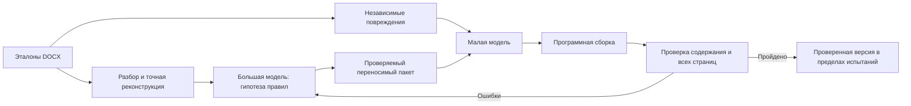

# Автономное извлечение и проверка переносимых шаблонов DOCX с использованием языковых моделей

Рабочая версия статьи. Основная таблица фиксирует историческую серию028;
последующие эксперименты описаны в дополнении ниже и [отчёте033](autonomy-033.md).
Это развитие рукописи024 с отрицательными результатами
на реальных документах. Описанный метод реализован частично; универсальность
и оптимальные вычислительные бюджеты не доказаны. Детальная внутренняя схема
пакета правил не раскрывается в тексте статьи; техническая спецификация проекта
хранится отдельно. Авторов, организацию и библиографическое оформление следует
указать перед подачей, не генерируя отсутствующие сведения.

## Аннотация

Исследуется извлечение переносимого шаблона оформления из одного или нескольких
документов DOCX без обучения параметров языковой модели. Предлагается программная
архитектура, разделяющая семантическое описание документа, точное хранение свойств
Office Open XML, применение шаблона меньшей моделью и независимую проверку.
В отличие от однократного извлечения, шаблон проходит цикл реконструкции эталона
и восстановления автоматически повреждённых копий. Генератор повреждений и
проверяющий модуль независимы от модели, создающей шаблон. Качество измеряется
совместно с временем, стоимостью и необходимостью участия человека.
В диагностической серии на восьми реальных документах один шаблон прошёл
полный цикл. Для одного из двух успешно импортированных документов увеличение
числа итераций до восьми сократило количество неоднозначных групп оформления
с трёх до одной, но не обеспечило точного восстановления. Шесть документов
остановились на ограничениях импорта до обращения к моделям. Результат показывает,
что автономность ограничена не только качеством LLM, но также выразительностью
представления, полнотой импортера и идентифицируемостью правил из образцов.

Ключевые слова: DOCX, извлечение шаблона, программная архитектура, агентный цикл,
языковые модели, визуальная верификация, автоматизация документов.

## 1. Задача и критерий успеха

Пользователь предоставляет оформленные образцы R, система строит переносимый
шаблон T и применяет его к новым документам X. Содержание X должно сохраняться;
меняются оформление и допустимый порядок смысловых блоков. Научная статья —
один из классов документов; регламент или план организации имеют другие роли,
титульные страницы, таблицы и служебные части.

Необходимо различать три утверждения. Первое — представление достаточно полно,
чтобы восстановить исходный экземпляр. Второе — шаблон и малая модель способны
восстановить тот же документ после заранее определённого повреждения. Третье —
правила корректно обобщаются на новое содержание. Первое не влечёт второго,
второе не доказывает третьего. В текущей работе отдельно учитываются все три
уровня, а отсутствие отложенной проверки указывается явно.

Есть принципиальная неоднозначность: одинаковые смысловые блоки могут иметь
разные свойства без наблюдаемого условия выбора. Восстановить такую разницу
из одного только текста в общем случае невозможно. Система должна хранить
неопределённость или получить дополнительное условие, а не скрывать различия.

## 2. Архитектура метода

DOCX рассматривается как пакет связанных XML-частей и ресурсов. Разбор сохраняет
границы абзацев, строковые фрагменты, таблицы, секции, объекты и служебные части.
Свойства оформления извлекаются программно. Большая модель предлагает смысловые
роли и переносимые условия, а компилятор связывает их с наблюдаемыми свойствами.
Присвоение уникальной роли каждому номеру абзаца не считается переносимым правилом.

Малая модель получает содержание нового документа и подготовленную инструкцию.
Она возвращает ограниченный структурированный план, не переписывает научный
текст и не формирует бинарный Word-файл. Сборку выполняет детерминированный код.
Это позволяет отделить ошибку семантического решения от ошибки записи формата.

Текстовая инструкция передаёт часть задачи от большой модели меньшей без
изменения весов. Это полезная интерпретация архитектуры, но сама по себе она
не является заявлением новой парадигмы обучения или доказанной научной новизны.
Предмет оценки — программный механизм такого переноса и его проверяемые свойства.

## 3. Независимость испытаний

Модель, создающая шаблон, не выбирает повреждённые примеры и не оценивает себя.
Генератор применяет фиксированную программу изменения шрифтов, цвета, интервалов,
отступов и допустимых перестановок. Малая модель не получает эталонный план
назначения свойств. Проверяющий модуль имеет доступ к эталону и сравнивает
содержание, связи, топологию и растровое представление всех страниц.

Неприменимая перестановка не считается успешным восстановлением. Нейтрализация
не означает перевод DOCX в простой текст: содержательные объекты, часть
семантических выделений и секционные границы остаются объявленными входными
сигналами. Это ограничивает интерпретацию результатов.

При неудаче цикл возвращает структурированную диагностику большой модели.
Невалидные ответы, неудачные запросы и дополнительные итерации учитываются.
Пользовательская обратная связь предусмотрена, но основной эксперимент
выполняется без неё. Вмешательство человека является отдельной метрикой.

## 4. Данные и условия эксперимента

Первые пять документов — опубликованные Word-образцы разных конференционных
форматов, уже использованные в предыдущем диагностическом опыте. Дополнительные
три — документы общего назначения: регламенты Canterbury и Dundee, а также
план непрерывности работы Cornwall. Последний содержит 12 страниц, обложку,
несколько секций и таблицы; регламенты содержат 22 и 19 страниц. Более длинные
документы не обрезались ради успешного прохождения.

Источники и SHA-256 приведены в индексах корпуса. Неудачная загрузка источника
фиксируется отдельно; недоступный файл нельзя считать испытанным. Сырые документы
не публикуются автоматически с исходным кодом. Выборочно проверен внешний вид
страниц. При реконструкции сравниваются все страницы в одинаковом рендерере
с фиксированными шрифтами; результат не гарантирует идентичную пагинацию в Word.

Это небольшой диагностический корпус, не репрезентативная случайная выборка.
В данной серии нет независимого набора новых текстов, поэтому оценки переноса
не приводятся. Дополнительные synthetic/replay результаты предыдущих серий
не объединяются с реальными вызовами данной серии в единую «точность».

## 5. Метрики и результаты серии 028

Основная метрика — доля эталонов, для которых самостоятельно выпущен пакет,
прошедший все применимые испытания. Дополнительные: время до успеха, API attempts,
стоимость, доля успешных без человека и причины остановок. Успех на префиксах
одной траектории измеряет необходимое число итераций именно этой траектории;
он не оценивает устойчивость по независимым повторным запускам.

Использованы GPT-6.1-sol для извлечения и Qwen3.8-27B для применения. В серии
выполнено 20 реальных запросов стоимостью $0,643582390. Один из восьми документов
прошёл полный цикл; это OSU, одна итерация и 23,10 секунды. У Бауманки за восемь
итераций и 658,21 секунды число конфликтных групп изменилось как
3,3,3,3,3,2,2,1. Остальные шесть документов не дошли до моделей из-за ограничений
импортера. Подробные машинные сводки сопровождают статью.

Условная успешность среди допущенных к моделям — 1/2, сквозная — 1/8.
Использование только условной оценки скрывало бы основной практический барьер.
Результат не позволяет установить число итераций, достаточное «в большинстве
случаев». В частности, увеличение их числа не исправляет неподдерживаемый XML.

## 6. Обсуждение и исследовательский вклад

Кандидат на вклад — проверяемая архитектура извлечения шаблонов, в которой
точное хранение оформления отделено от семантической классификации, а
автономность оценивается независимыми повреждениями. Данные показывают цену
такого разделения: ошибки становятся наблюдаемыми, но отказы нельзя скрывать
за визуально похожим результатом.

Для обоснования новизны относительно существующих методов необходимы прямые
сравнения: однопроходная LLM, детерминированный подбор стилей, цикл без визуальной
обратной связи, цикл без независимого корруптора и полный вариант. Нужны
замороженные обучающие/проверочные наборы по семействам документов, несколько
запусков на конфигурацию, модели меньшего размера и оценка локального применения.
Эти сравнения не подменяются unit-тестами и остаются незавершённой частью работы.

Языковая обратная связь без обновления весов имеет предшественников, включая
[Reflexion](https://arxiv.org/abs/2303.11366). Программную оптимизацию модельных
конвейеров рассматривают [DSPy](https://arxiv.org/abs/2310.03714) и
[TextGrad](https://arxiv.org/abs/2406.07496). Это основание для сравнений,
а не доказательство новизны нашего цикла. Проверенная краткая карта источников
и границы обзора приведены в [отдельной заметке](related-agent-work-028.md).

## 7. Заключение

Реализован и проверен встроенный цикл подготовки шаблона с независимыми
повреждениями и запретом выпуска непроверенного результата. Пилот выявил
различные источники ограничений: импорт, неоднозначность правил и итерационную
сходимость. Один реальный образец прошёл цикл полностью; универсальная система
для произвольных DOCX пока не получена. Последующие изменения импортера и новые
модельные прогоны должны оформляться отдельными сериями, сохраняя эти результаты.

## 8. Дополнение: последовательные серии029–033

Расширение импортера обеспечило точную реконструкцию экземпляров регламентов
на19 и22 страницах. Это не обеспечило автоматического получения переносимых
правил: у Dundee за8 итераций число конфликтов уменьшилось лишь с78 до77.
Таким образом, наблюдаемое плато нельзя объяснять исключительно недостаточным
числом обращений к модели. У Canterbury проявились также ограничения длины
ответа и временные отказы провайдера; они учитываются отдельно.

Две ошибки среды выполнения удалось причинно локализовать через повторное
применение сохранённых ответов: чрезмерную защиту порядка абзацев и избыточную
зависимость оформления от внутритекстовой роли. Исправления были внесены между
сериями, после чего проведены новые модельные испытания. В свежих опытах OSU032
и Tusur033 прошли полный цикл за одну итерацию каждый, включая независимые
повреждения, сохранность содержания, точные свойства и пиксельное сравнение.
Каждый цикл использовал4 модельных запроса; известная стоимость составила
соответственно0,005259 и0,018005USD. Эти результаты получены наdevelopment-корпусе,
не являются независимой оценкой обобщения и не объединяются со старыми версиями
в единую итоговую точность. Подробные методы, траектории, ограничения и полные
машиночитаемые отчёты приведены в [исследовании033](autonomy-033.md).

Результат поддерживает инженерную гипотезу: точность системы зависит не только
от размера модели, но и от контракта представления и проверяемых правил
исполнения. Он пока не устанавливает преимущество над альтернативами, оптимальный
размер модели, гарантированную точность или минимальный бюджет агента.

## Дополнение034: исправление исполнителя внутренним агентом

В контролируемом эксперименте агент получил право изменять ограниченные модули
сборщика в изолированном снимке. Проверяющий контур и ожидаемые результаты
оставались неизменными. При внесении исторического дефекта порядка полный
автоматический цикл предложил патч, прошёл десять проверок и повторил
teacher/student-обучение со свежими вызовами: reference_verified,9 запросов,
0,078181015USD. Это демонстрация механизма на development-случае, не оценка
универсального обобщения. Другой случай уменьшил число конфликтов33→30, но
не достиг готовности. Полная методология, изменения протокола, отрицательные
результаты и ограничения приведены в [исследовании034](engine-repair-034.md).
