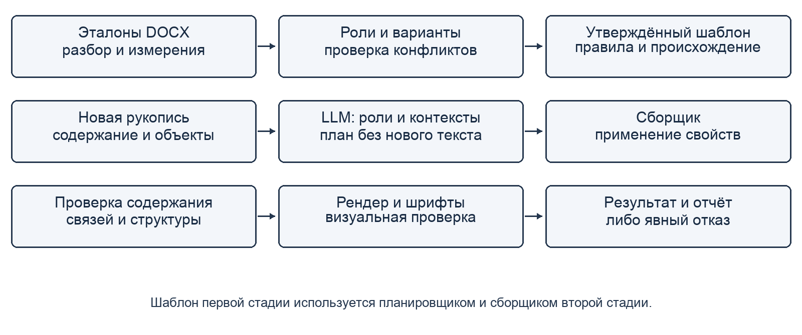

# Извлечение и применение шаблонов DOCX с языковыми моделями и проверяемой программной сборкой

Аннотация

Постановка проблемы. Автоматическое приведение научной рукописи к редакционному образцу требует согласованного изменения структуры и оформления при сохранении текста, формул, таблиц и связей. Стили Word не выражают все смысловые ограничения, а генерация документа языковой моделью затрудняет контроль неизменности содержания. Дополнительная проблема — стоимость многократного применения одного шаблона.

Цель. Разработать и экспериментально исследовать программный метод, который отделяет извлечение редакционных правил из DOCX от их применения, ограничивает задачу языковой модели семантическим планированием и переносит операции оформления в проверяемый сборщик.

Результаты. Представлены состав переносимого шаблона, контракт плана и протокол раздельной оценки модели, сборщика и полного процесса. В исследовании одного образца режим с доступными исходными свойствами дал по 10 полных совпадений в 10 попытках для двух модельных конфигураций; стоимость одной из них была в 16,75 раза ниже. Это результат восстановления известного документа, а не переноса на новые статьи. На синтетическом наборе разработки исправление программного контура повысило полную правильность разметки с 0/7 до 7/7 документов и пиксельное совпадение с 0/6 до 6/6 пар. Независимое обобщение и минимальный достаточный размер модели не установлены.

Практическая значимость. Метод позволяет хранить редакционные решения отдельно от весов модели, повторно применять утверждённые правила и выдавать проверяемые результаты с явными отказами и запросами недостающих сведений. Он создаёт основу для исследования экономичного массового оформления без повторной генерации научного текста.

Ключевые слова: обработка документов; DOCX; языковые модели; перенос оформления; семантическая разметка; программные ограничения; воспроизводимость.

## Введение

Подготовка статьи к публикации включает работу, слабо связанную с её научным содержанием: согласование уровней заголовков, сведений об авторах, частей аннотации, подписей, таблиц и библиографии. При смене издания эту работу часто приходится повторять. Образцом может служить уже принятая статья, но в ней правила смешаны с частными решениями автора. Жирное начертание, например, может обозначать заголовок, термин или название столбца. Перенос внешнего вида без понимания роли элемента способен разрушить структуру, а переписывание содержания ради получения подходящего макета — исказить результат исследования.

Перспективен подход, при котором редакционный опыт извлекается из образцов один раз и сохраняется в переносимом представлении. При обработке новой рукописи модель определяет назначение существующих фрагментов, а программный модуль применяет ранее утверждённые правила. Главный исследовательский вопрос состоит в том, насколько такое разделение ответственности позволяет сократить сложность модельного решения и стоимость повторного применения, сохраняя контролируемое качество. Предмет работы — программная организация решения вокруг готовых моделей; обучение новой нейросетевой архитектуры не выполняется.

В работе предложены представление шаблона с происхождением правил, ограниченный план преобразования и система проверок на границах стадий. Экспериментальная часть включает последовательность разработки и её отрицательные результаты, контроль сборщика на известном образце и регрессию на синтетическом корпусе. Такая постановка позволяет исследовать механизм ошибок до расширения на независимые редакционные стандарты. Возможность обработки произвольных документов и полностью автоматического извлечения нормативов рассматривается как дальнейшая цель, не как уже полученное свойство.

## Связанные работы

Автоматическая проверка оформления DOCX исследовалась до распространения современных LLM. В работе Nasyrov и соавторов [1] элементы документа классифицируются с помощью CatBoost, а регулярности их последовательности используются для проверки результатов классификации. Это близкая предметная постановка: локальное оформление необходимо рассматривать вместе со структурой. Настоящая работа изучает следующий операционный шаг — построение нового DOCX из существующего содержания по извлечённому шаблону. Прямое сравнение качества с системой [1] не проводилось; задачи, данные и критерии приёмки различаются.

Модели понимания документов, в частности LayoutLMv3 [2], объединяют текстовую и визуальную информацию. DocLayNet [3] показывает значение разнообразия макетов и содержит ручную разметку страниц нескольких типов документов. Эти работы важны для распознавания структуры, однако обнаружение области на изображении не задаёт способ безопасного изменения редактируемого пакета DOCX. В нашем случае доступны XML-элементы, свойства и отношения между частями пакета; их следует использовать непосредственно, а визуальное представление — для итоговой проверки. Из результатов [3] также следует методическое основание не ограничивать оценку одним редакционным образцом.

Идея управляемого программного контура для языковых моделей имеет самостоятельную исследовательскую основу. LMQL [4] объединяет инструкции, управляющие конструкции и ограничения вывода. DSPy [5] представляет модельные программы как композиции модулей и оптимизирует их по заданной метрике. Работа Geng и соавторов [6] исследует генерацию с грамматическими ограничениями для структурированных задач без дообучения. Эти подходы мотивируют разделение вероятностного выбора и формально проверяемого исполнения. В ArticleFlow применяется ограниченный ответ и проверка после его получения; собственный алгоритм грамматического декодирования не реализован.

Отличительная постановка данной работы — перенос редакционных правил между редактируемыми документами с одновременным контролем научного содержания, внутренних связей и визуального результата. Это сочетание определяет контракт программного метода и протокол его оценки. Утверждение о первенстве среди всех систем автоматической вёрстки не выдвигается. Заимствуется общий принцип программных ограничений, а исследуется его предметная реализация и влияние на нагрузку, которую требуется возложить на модель.

## Постановка задачи

Пусть D — входной документ, содержащий последовательность блоков B, связанные ресурсы O и отношения E. Блоком служит абзац, таблица или поддерживаемый фрагмент абзаца. Научное содержание C(D) включает текст с числами и знаками, формулы, содержимое таблиц, изображения и значимые связи. Оформление F(D) включает геометрию страницы, свойства абзацев и символов, параметры таблиц и другие поддерживаемые характеристики. Граница C и F задаётся контрактом: например, верхний индекс в формуле может быть частью содержания, хотя технически представлен свойством отображения.

По одному или нескольким корректно оформленным документам R требуется построить шаблон T, а затем получить D′ для новой рукописи. Допустимое преобразование сохраняет C(D), меняет только разрешённые компоненты F(D) и выполняет структурные ограничения T. Перестановка блоков допускается, если не нарушает защищённые диапазоны и связи. Недостающие сведения не выводятся из образца: вместо чужой фамилии или выдуманной организации создаётся явно обозначенный запрос к автору. Если вход содержит неподдерживаемую конструкцию, система должна сохранить исходник и вернуть объяснимый отказ.

Схема вычисления имеет вид T = Extract(R, U), P = Plan(D, T, M), D′ = Build(D, T, P), где U обозначает подтверждённые редактором решения, M — выбранную модель, а P — ограниченный план. Шаблон описывает роли, допустимые варианты оформления и правила порядка; план связывает их с существующими элементами конкретной рукописи. Свойство корректности плана не эквивалентно правильности решения: формально допустимая роль может быть семантически ошибочной. Поэтому синтаксическая проверка ответа, оценка разметки и проверка готового документа выполняются раздельно.

Исследуются три вопроса. Первый: какие решения можно перенести из модели в детерминированный код без потери необходимой гибкости? Второй: как полнота доступной информации об исходном документе влияет на точное восстановление оформления и стоимость модельного выбора? Третий: какие проверки выявляют ошибки, скрытые за высокой долей правильно размеченных блоков? Гипотеза о возможности массового применения шаблона малыми моделями проверяется частично; вывод о минимальном числе параметров требует отдельного сравнения моделей при одинаковом режиме входа.

## Метод и программная архитектура

DOCX рассматривается как пакет взаимосвязанных частей согласно ECMA-376 [7]. Разбор начинается с проверки контейнера и поддерживаемого профиля OOXML. Затем извлекаются элементы основного документа, стили, тема, нумерация и связи с ресурсами. Абзац может содержать несколько текстовых фрагментов с разными свойствами; оформление вычисляется с учётом наследования и прямых переопределений. Только чтение имени стиля недостаточно: одинаково названные стили в разных документах могут давать разный результат. Система сохраняет исходные ресурсы и идентификаторы для последующего контроля, не превращая весь документ в свободный текст.

Измеренные свойства образцов группируются по смысловым контекстам: название, метаданные, части аннотации, основной текст, заголовки, подписи, таблицы и библиография. Шаблон содержит измерения, допустимые варианты, обязательность блоков и ограничения порядка. Происхождение наблюдения сохраняется отдельно для объяснения решения редактору. Позиция абзаца или цитата из образца не используются как правило выбора оформления новой статьи. Для каждой роли важен переносимый признак назначения, а не совпадение с известным текстом.

Один образец обычно не определяет единственное правило. Разная ширина таблиц может быть обусловлена числом столбцов; выделение отдельного слова — содержанием. Поэтому извлечение наблюдений и утверждение нормы разделены. В текущей реализации конфликтующие варианты доступны для выбора, а исследовательская конфигурация использует заранее зафиксированное правило выбора. Полноценный автоматический цикл разрешения противоречий между несколькими эталонами и генерации контрпримеров остаётся задачей развития. Участие редактора на стадии утверждения должно учитываться как стоимость подготовки шаблона, даже если последующее применение автоматизировано.

Рис. 1. Подготовка переносимого шаблона и применение к новой рукописи. Контрольные эталоны используются оценщиком; правильная разметка новой статьи не передаётся планировщику.

На стадии применения модель получает инвентаризацию существующих блоков и словарь допустимых ролей и контекстов. Она возвращает привязки к исходным идентификаторам, а не текст статьи. Проверяются полнота покрытия, уникальность идентификаторов, допустимость роли и совместимость контекста. Для явно подписанных частей аннотации могут использоваться детерминированные символьные границы; сложные объекты не разрезаются произвольно. Выбор неподдерживаемого варианта завершает попытку ошибкой. Исправление ответа другим вызовом или человеком образует отдельный режим и не включается в результат одного прохода.

Сборщик применяет разрешённые свойства к исходным XML-элементам, сохраняет научные фрагменты и переносит их в согласованном порядке. Для аннотации это, например, постановка проблемы, цель, результаты и практическая значимость перед ключевыми словами. Значения нумерации и идентификаторы связей принадлежат пакету: копировать их из образца как обычное оформление нельзя. Аналогично перенос закладки требует сохранения охватываемого ею содержания, а не только пары XML-маркеров. Редакторские заметки сохраняются отдельно; их отделение от научного текста требует подтверждения, если назначение неоднозначно.

После сборки сравниваются сигнатуры защищённого содержания, ресурсы и связи, проверяются обязательные блоки и поддерживаемость оформления. Затем DOCX рендерится в фиксированном окружении. Проверка фактически использованных PDF-шрифтов дополняет проверку установленных гарнитур: наличие Arial в системе ещё не означает, что конкретный процесс рендера его использовал. Пользователь получает результат, исходник и отчёт. Готовность означает прохождение предусмотренных проверок и разрешение вопросов; успешная запись ZIP-контейнера сама по себе не является критерием приёмки.

## Протокол и материалы эксперимента

Оценка организована на трёх уровнях. Контроль сборщика использует заведомо правильный план и измеряет только исполнение. Проверка модели оценивает предсказанные роли и контексты на замороженных входах. Сквозной опыт включает модель, валидацию, сборку и рендер, причём отказ провайдера остаётся в знаменателе. Для каждой попытки фиксируются конфигурация, хеши данных, результат, задержка и расходы. Изменение запроса, схемы или алгоритма начинает новую серию; предыдущие неуспехи не удаляются.

Нужно различать режимы доступной информации. В нейтральном режиме исходное оформление удалено, и выбор опирается на текст и объявленную структуру. В режиме I3 планировщику и программной части доступны исходные свойства DOCX. Контроль с правильным планом является отдельным режимом oracle. Эти условия нельзя объединять в одну оценку точности. Если два допустимых исходных документа после нейтрализации дают одинаковый вход, но требуют разных целевых выделений, восстановление обоих без дополнительной информации неидентифицируемо. Исправлять это увеличением модели бессмысленно: необходимо уточнить норматив или предоставить недостающий сигнал.

Ранний пилот использовал один настоящий образец научной статьи объёмом 12 страниц. Он подходит для строгого контроля содержания, сложных объектов и пиксельного совпадения, но повторные вызовы на этом образце не являются независимой выборкой статей. Затем создан воспроизводимый синтетический корпус из 19 DOCX: три семейства оформления, шесть обучающих эталонов, шесть целевых документов, шесть неоформленных входов и один вход с пропущенными обязательными сведениями. В набор включены разные роли, части аннотации и сложные элементы. После исправлений по его ошибкам корпус рассматривается как набор разработки и регрессии.

Таблица 1. Основные показатели и единицы оценки

| Показатель | Определение | Что не доказывает |
|---|---|---|
| Точность ролей | Правильные роли / все размечаемые блоки | Полную правильность документа |
| Полная разметка | Документы без ошибок ролей / все входы | Правильность типографики |
| Сохранность | Документы с сохранённым защищённым содержанием / все входы | Соответствие редакционному шаблону |
| Пиксельное совпадение | Точные пары при одном renderer, DPI и шрифтах / все пары | Перенос на независимую статью |
| Сквозная готовность | Принятые без исправления документы / все попытки | Надёжность вне данного корпуса |
| Стоимость и задержка | Все расходы и полное время попыток | Локальную скорость или расход GPU |

Для документа i строгий индикатор успеха задаётся как произведение индикаторов доступности ответа, корректности плана, сохранности, правильности структуры и оформления, а также наличия обязательных данных. Итоговая доля — сумма этих индикаторов, делённая на число всех запланированных попыток. Условную точность среди полученных ответов можно приводить дополнительно, но она отвечает на другой вопрос. Пиксельная метрика применяется только при наличии целевого документа с тем же содержанием; сравнивать новый текст непосредственно с изображением другой статьи некорректно.

В исследовании использованы идентификаторы провайдера openai/gpt-6.1-sol, openai/gpt-6-luna и qwen/qwen3.8-27b. Точные настройки и машинные сводки опубликованы в материалах проекта [8]. Название линейки закрытой модели не определяет её число параметров. Поэтому сопоставление Sol и Luna интерпретируется через наблюдаемую стоимость и качество, а не как доказанная зависимость от размера сети. Локальные и квантизованные модели не измерялись. Сырые реальные рукописи и закрытый prompt не публикуются; это ограничивает независимое повторение части опытов и явно учитывается в выводах.

## Результаты и последовательность оптимизации

Первый значимый контроль отделил способность сборщика воспроизвести образец от способности модели выбрать оформление. В серии 004 десять сборок с известным правильным планом совпали полностью; новых вызовов модели в этом контроле не было. В серии 005 модель выбирала элементы оформления из каталога. Ни одна из десяти попыток не дала полного совпадения. Для девяти оценённых выходов роли и размещение были правильными, но оставались ошибки стилей и защищённых внутритекстовых свойств; ещё один план отклонён. Следовательно, правильная структура верхнего уровня недостаточна для точного документа.

Следующая оптимизация перенесла сохранение исходных свойств и проверку совместимости в программный контур. В режиме I3 серии 007 две конфигурации дали по 10/10 полных совпадений. Средняя подтверждённая стоимость API составила 0,02627206 USD для Sol и 0,0015687685 USD для Luna, отношение — 16,75. Медианы задержки составили 28,30 и 19,27 с соответственно. Сравнение относится к одному повторяемому входу, конкретным настройкам и наблюдаемому кэшированию. Оно показывает возможность более дешёвого решения в этом режиме, но не доказывает причинный эффект размера модели или решение нейтрального переноса.

Таблица 2. Контроли и модельные серии на одном образце

| Серия | Условия | Полное совпадение | Интерпретация |
|---|---|---|---|
| 004 | Правильный план, без LLM | 10/10 сборок | Контроль исполнителя |
| 005 | Модель выбирает каталог оформления | 0/10 попыток | Ошибки тонкого оформления |
| 007 | I3, Sol | 10/10 попыток | Исходные свойства доступны |
| 007 | I3, Luna | 10/10 попыток | То же условие, меньшая цена API |
| 008 | I3, Qwen, reasoning medium | 6/10 попыток | Три обрезания, один HTTP 429 |
| 009 | I3, Qwen, без reasoning | 9/10 попыток | Один HTTP 429; все девять выходов точны |

Серии Qwen демонстрируют различие между качеством полученного результата и надёжностью полного процесса. После изменения режима reasoning строгая доля выросла с 6/10 до 9/10, а среди девяти завершённых выходов второй серии точными были все. Ошибка HTTP 429 не является ошибкой семантического выбора, но для пользователя означает отсутствие готового документа. Приписывать системе результат 100% по этой серии было бы неверно. Разные режимы reasoning составляют разные конфигурации, а не взаимозаменяемые повторы одного опыта.

При переходе к синтетическому корпусу выявились ошибки разрешения свойств, выбора семантических контекстов и интерпретации блоков. В серии 018 были правильны 138 из 152 ролей, то есть 90,79%, но полностью правильной разметки не имел ни один из семи документов. После исправлений серии 019 получены 152/152 роли, 7/7 полностью правильных разметок и 6/6 точных пиксельных пар. Содержание сохранялось в 7/7 случаев до и после изменений. Таким образом, улучшение блочной метрики на 9,21 процентного пункта сопровождалось существенным изменением документного результата. Это наблюдение на наборе разработки, не оценка точности на новых статьях.

Таблица 3. Регрессия программного контура и отдельные модельные конфигурации

| Конфигурация | Полная разметка | Точные пары | Подтверждённая стоимость API |
|---|---|---|---|
| Правила и сборщик 018 | 0/7 | 0/6 | Без LLM |
| Исправленный контур 019 | 7/7 | 6/6 | Без LLM |
| Qwen, первый контракт 019 | 1/7 | 1/6 | 0,013909920 USD |
| Qwen, исправленный контракт 019 | 7/7 | 6/6 | 0,013941240 USD |
| Luna, финальная серия 019 | 7/7 | 6/6 | 0,004071725 USD |

В модельных опытах Qwen первоначально принимала библиографическую запись за редакторскую заметку. Затем обнаружилось несоответствие разрешённой роли и словаря контекстов. Уточнение инструкции само по себе не устранило программный дефект; после его исправления выполнена новая серия с результатом 7/7 и 6/6. Sol с неподдерживаемой настройкой reasoning вернула семь HTTP 400; эти неуспехи учтены отдельно. Конфигурация Sol/low обработала шесть обучающих эталонов, а Luna применила полученные шаблоны к семи входам с 7/7 правильных разметок и 6/6 точных пар. Это проверяет работоспособность разделения стадий на данном корпусе, но не доказывает оптимальность выбора модели для извлечения.

Рендер также оказался источником скрытой ошибки. Системный поиск шрифтов находил Microsoft fonts, но используемый процесс LibreOffice подменял их. Проверка PDF выявила расхождение. После настройки окружения четыре пары с Arial и Times New Roman дали точное совпадение с настоящими требуемыми шрифтами. Две пары с Calibri совпали при одинаковой подмене; их нельзя считать подтверждением Calibri. Сохранение 6/6 в прежнем окружении позволило отделить эффект исправления сборщика от смены шрифтов. Для настоящего исходного образца подтверждены 12/12 точных страниц; это контроль сохранности того же содержания.

## Обсуждение

Результаты показывают, почему размер модели не следует рассматривать отдельно от формы задания. Выбор множества низкоуровневых свойств создаёт длинный ответ и большое число возможностей для локальной ошибки. Когда модель выбирает только смысловые роли и допустимые контексты, исполнение можно проверять независимо. Вместе с тем программное сохранение исходных свойств добавляет информацию, недоступную нейтральному входу. Улучшение между этими режимами нельзя целиком приписать более удачному prompt или программной оптимизации: изменилась сама информированность системы. Для причинной оценки нужны абляции при одинаковых данных и модели.

В экономическом отношении подготовка шаблона и его применение имеют разную частоту. Средняя стоимость одного принятого документа зависит от стоимости извлечения, числа применений, частоты отказов и объёма ручной проверки. Для N попыток её можно выразить как (C_подготовки + сумма C_API + C_проверки) / N_принятых. Приведённые API-цены измеряют лишь один компонент. Выгода от повторного использования появляется при устойчивом шаблоне и достаточном числе документов; частые ручные исправления могут её устранить. Сравнение с прямой генерацией полного DOCX и измерение времени редактора в текущем эксперименте отсутствуют.

Рис. 2. Уровни проверки метода. Совпадение известного образца, регрессия после исправлений и независимая оценка отвечают на разные вопросы; переход к следующему уровню требует новых данных.

Перенос опыта без изменения весов здесь означает сохранение проверенных правил во внешнем артефакте. Такой шаблон можно версионировать, обсуждать с редактором и применять с другой моделью. Его полезность зависит не от объёма описания, а от того, насколько однозначно он задаёт допустимые решения. Наблюдаемое оформление ещё не является нормативом: без различения правила и случайной особенности образца извлечение может закрепить ошибку. Поэтому происхождение правил, контроль конфликтов и явное состояние неопределённости — часть метода, а не вспомогательная функция интерфейса.

Основные угрозы валидности связаны с объёмом и зависимостью данных. Повторные запросы к одному образцу оценивают устойчивость на этом входе; синтетические документы одного генератора разделяют его предпосылки. Исправление по ошибкам набора делает его непригодным для независимой оценки обобщения. Полный успех 7/7 не следует превращать в статистическую гарантию для потока реальных рукописей. Кроме того, не проведено сравнение разных версий Microsoft Word, а частные ограничения OOXML уменьшают область поддерживаемых входов. Неподдерживаемые документы должны входить в отчёт о покрытии, а не исчезать из выборки.

Для следующего этапа необходим заранее замороженный корпус нескольких редакционных семейств с независимой разметкой и согласованием разногласий. На нём следует раздельно варьировать число эталонов, модель извлечения, модель применения, доступность исходного оформления и набор программных проверок. Потребуются контрпримеры с многоязычными аннотациями, нумерацией, закладками, формулами и секциями. Сравнение малых открытых и квантизованных моделей должно дополнительно учитывать память, локальную задержку и долю ручной проверки. Только такой опыт позволит определить границу достаточного размера модели и переносимость метода на другие классы документов.

## Заключение

Предложен программный метод переноса оформления DOCX, разделяющий извлечение редакционных правил, семантический выбор языковой модели и детерминированную сборку. Его основные элементы — переносимый шаблон с происхождением решений, ограниченный план над существующим содержанием и многоуровневая проверка результата. Научная ценность подхода состоит в проверяемой организации взаимодействия готовой модели с документом и в раздельном измерении ошибок компонентов.

Эксперименты подтвердили возможность точного восстановления известного образца при доступных исходных свойствах и получение такого результата с существенно разной стоимостью API. На наборе разработки исправление программного контура повысило полную правильность разметки с 0/7 до 7/7, сохранив содержание. Эти данные обосновывают дальнейшее исследование ограниченного планирования и повторного использования шаблонов. Универсальное извлечение правил, независимый перенос и применение минимальных локальных моделей остаются открытыми экспериментальными задачами.

## Список литературы

1. Nasyrov N., Komarov M., Tartynskikh P., Gorlushkina N. Automated formatting verification technique of paperwork based on the gradient boosting on decision trees // Procedia Computer Science. 2020. Vol. 178. P. 365–374. DOI: 10.1016/j.procs.2020.11.038.

2. Huang Y., Lv T., Cui L., Lu Y., Wei F. LayoutLMv3: Pre-training for Document AI with Unified Text and Image Masking // Proceedings of ACM Multimedia. 2022. DOI: 10.1145/3503161.3548112.

3. Pfitzmann B., Auer C., Dolfi M., Nassar A. S., Staar P. W. J. DocLayNet: A Large Human-Annotated Dataset for Document-Layout Analysis. 2022. arXiv:2206.01062. https://arxiv.org/abs/2206.01062.

4. Beurer-Kellner L., Fischer M., Vechev M. Prompting Is Programming: A Query Language for Large Language Models. 2023. arXiv:2212.06094, version 3. https://arxiv.org/abs/2212.06094.

5. Khattab O., Singhvi A., Maheshwari P. et al. DSPy: Compiling Declarative Language Model Calls into Self-Improving Pipelines. 2023. arXiv:2310.03714. https://arxiv.org/abs/2310.03714.

6. Geng S., Josifoski M., Peyrard M., West R. Grammar-Constrained Decoding for Structured NLP Tasks without Finetuning // Proceedings of EMNLP. 2023. P. 10932–10952. https://aclanthology.org/2023.emnlp-main.674/.

7. Ecma International. ECMA-376. Office Open XML file formats. Part 1, 5th ed., 2016; Part 2, 5th ed., 2021. https://ecma-international.org/publications-and-standards/standards/ecma-376/.

8. ArticleFlow. Материалы экспериментов 004–009 и 019: протоколы, машиночитаемые сводки и синтетический корпус. Исходное состояние статьи: commit 71e1127d435fe87ec04f73d6687d24c6d302f538. 2026. https://github.com/timuroid/articleflow/tree/71e1127d435fe87ec04f73d6687d24c6d302f538/docs/research.
