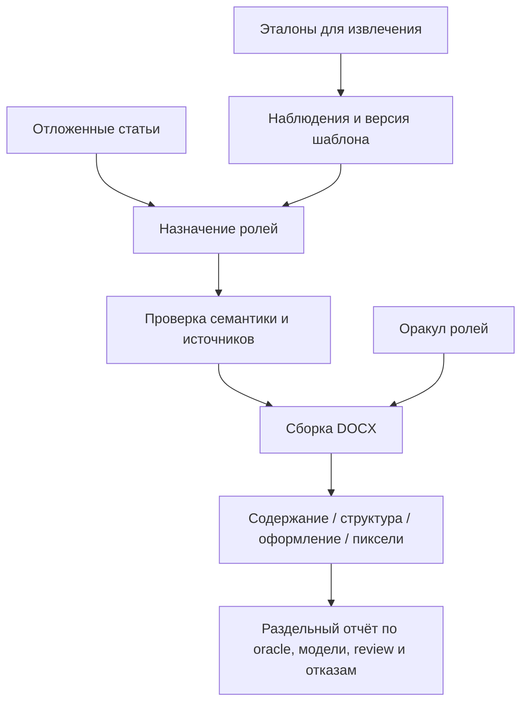

# Журнал восстановления сведений об исследовании 017

Дата записи: 17 октября 2026 года. Источник — зафиксированное описание предшествовавшей локальной работы и сохранившийся публичный репозиторий. Это **не повторный эксперимент**: исходные файлы, журналы модели, полный код Web 017 и контрольные DOCX не доступны в текущей рабочей среде. Числа ниже следует считать историческим отчётом до восстановления исходных артефактов. Не добавлять их в сводную таблицу воспроизводимых результатов как новые попытки.

## Исследовательский вопрос

Может ли система извлечь из одного или нескольких оформленных DOCX переносимый профиль, назначить фрагментам новой статьи смысловые роли при помощи небольшой модели и детерминированно перестроить документ, сохранив содержание и детали оформления? Новизна исследуется в устройстве программного контура вокруг моделей, а не в обучении новой модели. Извлечение шаблона и массовое применение оцениваются отдельно. Реалистичный критерий включает **корректность структуры**, полную сохранность исходных фрагментов, оформление, отказы, задержку, расходы и участие человека. Один точный образец не доказывает перенос на невидимые статьи.

## Методология прежней локальной серии

- Встроенный эталон «Русского инженера» был привязан к конкретному DOCX пользователя по SHA-256; чужой одноимённый образец не подменял его. Проверялись не только общие стили, но и отдельные жирные подписи внутри аннотации.
- Структурный план указывал исходные узлы и, для простого текста, точные диапазоны. Код проверял принадлежность каждого диапазона источнику и сохранность OOXML. Форматирование применялось после решения о порядке фрагментов.
- Синтетический контроль охватывал 24 перестановки четырёх явно подписанных частей аннотации. Каждый четвёртый пример содержал сложные объекты (изображение, таблицу, формулу и ссылку). Контрольное ожидаемое состояние составлялось независимо от исследуемого планировщика. Это проверка инвариантов и порядка, **не** независимая оценка понимания произвольных статей.
- Для локального веб-среза проверялись версии шаблона, HTTP-состояния, ревизии, пакетная обработка и блокировка готового результата при вопросах. В интерфейсе дополнительно выполнялась DOM-проверка на живом API; визуального аудита в настоящем браузере не было.
- Отдельная попытка модели `qwen/qwen3.8-27b` для нового структурного контракта закончилась **HTTP 429** до валидного результата. Следовательно, для серии 017 нет измеренной доли правильно размеченных документов Qwen. Успехи старых серий 014 и 009 переносить на новый контракт нельзя.

## Сохранённые количественные сведения

| Проверка / попытка | Сообщённый результат локальной серии | Правильная интерпретация |
| --- | --- | --- |
| Полный Python suite после Web 017 | 159/159 тестов | Проверял прежнюю локальную сборку; код и полный log нужно восстановить |
| Given/When/Then для структурного веб-пути | 6/6 сценариев, 20 steps | Не работают в нынешнем GitHub без Web 017 и definitions |
| DOM-сценарии | 10 passed | Не равно визуальной проверке в браузере |
| Синтетические перестановки аннотации | 24/24 | Явные роли; не unseen transfer и не модельные прогоны |
| Настоящий вызов Qwen3.8-27B в серии 017 | Один HTTP 429 | Точность роли/структуры не измерена |
| Локальный пример рукописи по образцу | 7 страниц, 0 текстовых выходов за страницы, 4 жирные подписи | Остался **черновиком**: 6 недостающих полей и 2 неразмеченных фрагмента аннотации |

Для неуспешного модельного вызова был зарезервирован неизвестный расход `0.04297928 USD`, а сумма предыдущих и новых обязательств оценивалась в `10.244793114 USD` при локальном cap `14.875251924 USD`. **Это исторический snapshot, а не текущий баланс OpenRouter.** Без исходного usage ledger и новых тарифов не запускать платные попытки и не обнулять накопленные расходы.

## Ограничения и следующие независимые проверки

1. Получить исходники, версию релиза, corpus manifest и журналы от владельца. Сверить тесты и hashes, отделить настоящие модельные вызовы от replay, оракула и ручной разметки.
2. Собрать эталоны нескольких конференций по 1–10 DOCX на шаблон. Разделить **по конференции или по независимому набору документов**, чтобы правила не настраивались на скрытый контроль. Хранить права и реальные файлы вне публичного Git.
3. Для каждого источника разметить структуру, инлайн-выделения, подписи, таблицы, рисунки, формулы и спорные места. Зафиксировать разногласия аннотаторов до запуска моделей.
4. Сравнить извлечение без модели, сильной моделью и с обратной связью; после утверждения шаблона — применения одной большой и нескольких малых моделей. Измерять exact match всей структуры, F1 ролей, полноту payload, фактические шрифты, визуальную ошибку, процент отказов, стоимость и задержку. Для каждой конфигурации учитывать **все** попытки, включая HTTP 429.
5. Отдельно считать полностью автоматический one-pass, ручной review и повторные попытки. Готовый DOCX с заполнителем не равен 100% автоматическому успеху.

Прежние публичные серии и их полноценные исходные таблицы: [пилот 001](pilot-001.md), [точный oracle 004](renderer-004.md), [планировщик 005](planner-005.md), [I3 007](source-aware-007.md), [Qwen 008/009](qwen-009.md). Техническая инвентаризация недостающего кода — [Web 017](../tech/web-017-recovery.md).
