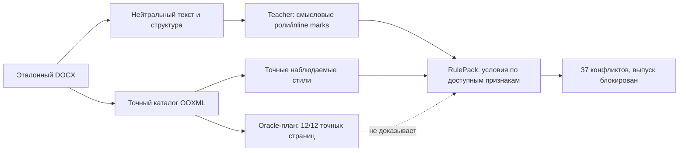

# Почему точный каталог не стал переносимым правилом: дополнение к серии 036

Дата: 18.10.2026. Это **offline-анализ** сохранённых результатов
[серии 036](evaluation-036.md) и проект следующего эксперимента. Новых
LLM-вызовов для приведённых ниже сравнений сегментации не выполнялось.
Реальный DOCX, точные фрагменты текста и исходные ответы моделей остаются
закрытыми.

## Разделение трёх результатов

Эталон удалось точно разобрать и восстановить: 12/12 страниц совпали при
144 DPI, свойства и содержание сохранены. Это доказывает способность
парсера и сборщика повторить **один экземпляр** при известных назначениях.
Компилятор переносимого шаблона решает другую задачу: из содержания и
структуры нового документа должен выбрать те же полные свойства без доступа
к оформлению эталона. В лучшем валидном пакете D эта задача остаётся
неразрешённой — **37** конфликтных групп: **7 абзацных, 28 символьных и 2
разделителя**. Student до готового документа в автономной серии D не дошёл.

## Где теряется различие

В **17/28** символьных конфликтных групп разные точные target-стили лежат
внутри одного семантического диапазона: даже идеально предсказанная метка
этого диапазона не подскажет, где сменить стиль. Среди **32** просмотренных
смешанных семантических диапазонов **31** обозначен `plain`. Это два разных
знаменателя — группы конфликтов и диапазоны, их доли нельзя складывать.
Модель не получила в контракте достаточно выразительного способа сообщить
правило поддиапазонов; простое повторение той же задачи на большем числе
итераций не устраняет нехватку признаков.

Проверка вычисленных свойств не сделала эти расхождения фиктивными: ни одна
из 28 символьных конфликтных групп полностью не исчезла после расчёта
эффективного `rPr`. Только в 2 из 7 абзацных групп различия ограничены
свойствами знака конца абзаца `pPr/rPr`; точный XML и там различается.

| Offline fit на том же эталоне | Конфликты абзацев + знаков | Покрытие символьных смещений |
| --- | ---: | ---: |
| Исходные семантические диапазоны | 35 = 7 + 28 | 43,17% |
| Независимое деление каждого диапазона по Unicode-классу | 73 = 7 + 66 | 67,70% |
| Unicode-класс плюс классы соседей слева/справа | 157 = 7 + 150 | 70,88% |

Два конфликта layout-spacer в таблицу не входят, поэтому её baseline — **35**,
а не 37. Покрытие означает долю символьных смещений, для которых refit на
обучающем экземпляре вывел однозначное правило; это не точность на новых
документах. Более мелкое разбиение подняло train-покрытие, одновременно
умножив несовместимые группы. Таким образом, Unicode-сегментация сама по
себе не является исправлением. Это чувствительность к признакам на одном
документе, не новая teacher-разметка и не held-out результат.

## OOXML и визуальная эквивалентность

Несколько ограниченных offline-проб подставляли альтернативные свойства в
исходный oracle-план для 35 не-spacer конфликтных групп. При одном renderer
и 144 DPI результаты зависят от выбора альтернативы и направления:

| Протокол | Объём | Видимое отличие | Совпадающие пиксели |
| --- | ---: | ---: | ---: |
| Ранняя representative-альтернатива, одно направление | 35 замен: одна на группу | 14/35 групп | 21/35 групп |
| First-support sweep, одно направление | 47 замен в тех же 35 группах | 20/35 групп | 15/35 групп |
| Проверка также обратной замены | те же 35 групп, два проверенных контекста | 21/35 видимы хотя бы в одном | 14/35 одинаковы в обоих |

В первом протоколе из 7 абзацных групп 1 была видимой и 6 пиксельно
совпали; из 28 символьных — соответственно 13 и 15. **47** во второй строке
обозначает количество замен, а **35** в дробях — количество групп после
сведения повторов; эти знаменатели нельзя смешивать. Все 28 символьных
замен первого протокола изменили вычисленные свойства OOXML. Два
spacer-конфликта этими пробами не проверялись.

Даже пиксельное совпадение в обоих этих контекстах не означает равенства
шрифтов, свойств DOCX, поведения Word/LibreOffice или совместного эффекта
нескольких замен. При текущем запросе на точное оформление эти варианты
**сохраняются как различия**. Отдельный визуальный показатель помогает
приоритизировать диагностику, но не снижает строгий gate незаметно.

Во время аудита этой пробы обнаружился и дефект прежней **метрики**, а не
подтверждение эквивалентности: `format032` не сравнивал разрешённое `rPr`
знака конца абзаца. Четыре абзацные группы, которые казались безвредными по
старому `paragraphs_exact` вместе с пикселями, имеют точные XML-различия;
прямая проверка каталога показывает, что лишь две из семи групп ограничены
свойствами знака абзаца, у других затронут и `pPr`. Исправленный evaluator
добавил отдельное `paragraph_marks_exact`: на проверенном представительном
варианте прежние `paragraphs_exact=true` и совпадающие пиксели сохранились,
но `paragraph_marks_exact=false` и общий `property_exact=false`. Полную
перепроверку всех замен новым evaluator нельзя подменять этим одним тестом.

## Экспериментальная грамматика и контроль 037

Нужна [предлагаемая грамматика диапазонов](../tech/adr/011-span-grammar-and-ambiguity.md):
teacher описывает смысловую и структурную причину границ внутри абзаца,
детерминированный код применяет разрешённые признаки к новому тексту, а
компилятор связывает результат с полными наблюдёнными OOXML-вариантами.
Если причины нет или наблюдения противоречат друг другу, сохраняется
неоднозначность и пользователь получает локальный вопрос. Узкий
`role + inline_role + character_class` реализован как экспериментальный
профиль; более широкая семантическая грамматика остаётся гипотезой.

Контрольный **offline-этап с истинными метками**, без LLM, выполнен на
[полностью синтетической family 037](../../datasets/span-grammar-v037/README.md).
Три эталона по 44 абзаца имеют общие ресурсы и секцию; каждый занимает
четыре страницы. Генератор заранее задаёт иерархическое правило. Для
трёх эталонов fit дал **0 конфликтов и 43 правила** грамматики. Отдельный
held-out документ с новым содержанием проверен на двух независимо
испорченных входах: I2 с сохранённым смысловым выделением и I1 с изменёнными
bold/italic и run-границами. При oracle-ролях абзацев и oracle-inline-метках
оба входа дали **0 unresolved**, точное содержание и свойства DOCX, а также
**4/4 пиксельно одинаковые страницы каждый** при 144 DPI. Отрицательный
контроль с одинаковым наблюдаемым контекстом и разными targets дал **4
символьных конфликта**, `ambiguous` и отказ `SPAN_GRAMMAR_AMBIGUOUS`.
Название I1 относится здесь к степени порчи входного DOCX; разметку смысловых
диапазонов для offline-контроля всё равно предоставил oracle. Это не успех
строгого model-only I1.

Второй **offline oracle-held-out** намеренно изменяет структуру внутри той же
синтетической family: **56 абзацев, четыре раздела, два рисунка и пять
страниц**; в разделах неодинаковые серии основных абзацев (5/9/6/11).
Новый текст и размещение дополнительного рисунка не служили признаками
fit по трём исходным эталонам. При заранее известных истинных ролях и
inline-метках тот же fit получил **0 обучающих конфликтов и 43 правила**, а
независимо испорченный I1 дал **0 unresolved**, точные содержание и свойства
DOCX и **5/5** одинаковых страниц при 144 DPI. Этот контроль показывает
выразительность грамматики и сборщика при более длинном и иначе повторённом
содержимом. Его первый платный student-прогон описан ниже отдельно: он
не входит в 5 API-попыток первоначального сквозного опыта.

Это показывает выразительность и проверяемость узкого контракта при
**правильных метках**, а не способность teacher самостоятельно вывести
метки или правила и не перенос на реальные DOCX. Тот же экспериментальный
селектор, применённый offline к лучшему сохранённому пакету реального D,
дал **92 конфликта = 7 абзацных + 83 символьных + 2 spacer** при 77
выведенных правилах. По сравнению с прежними 37 конфликтами прироста
качества на этом реальном примере нет; число правил не является метрикой
переноса. Новых LLM-вызовов в обоих offline-опытах не было.

## Первый реальный teacher/student-прогон на synthetic 037

Отдельный платный опыт на замороженной family 037 завершился
`reference_verified` после **одного** вызова teacher `openai/gpt-6.1-sol`
с `reasoning_effort=low`: все три эталона по 44 абзаца разобраны с **0
обучающих конфликтов**. `qwen/qwen3.8-27b` с `reasoning_effort=none`
вызван по одному разу для каждого эталона; **3/3** независимых применений
прошли проверки содержания, свойств и страниц. Затем **одним новым**
Qwen-вызовом обработан held-out I1 с другим содержанием: 44 абзаца и четыре
страницы, изменённые bold/italic, шрифты, цвета и границы runs. Он дал **0
unresolved**, все пять проверок целостности успешны, `property_exact=true`
и **4/4** пиксельно одинаковые страницы с golden. Всего **5 реальных
API-попыток**, $0,111975625 подтверждённых расходов, 155,805 с по настенным
часам; попыток с неизвестной ценой нет.

Это первый сквозной результат **для одного синтетического семейства с общей
структурной формой**. Он не означает точность на произвольных DOCX, других
семействах и реальном D; здесь не измерены устойчивость на независимых
повторных запусках, предел минимального размера модели или влияние числа
эталонов. На платном этапе проверен один новый I1-вход; успешный offline I2
с oracle-метками не является вторым платным model trial. Разделение teacher,
student, held-out golden и исходные артефакты сохранены в закрытом протоколе;
публичные данные содержат только агрегаты и код без ответов модели.

## Ассистированная разметка через внешний JSON

Параллельно доступен [offline-импорт](../tech/external-semantic-import-037.md)
строгого JSON-плана `roles/groups/inline_roles/inline/questions`, полученного
внешним Codex или редактором. Его аналитическое описание может выявить
пропущенную границу, но не является ни точным OOXML-каталогом, ни исполняемым
правилом для нового текста. Импортёр проверяет полное покрытие абзацев и
точность цитат, затем компилирует **черновик** по тем же наблюдениям. Отчёт
отдельно показывает train-конфликты; статус `draft_compiled` при их отсутствии
не означает сертификацию. Этот путь — метод получения/отладки кандидатной
разметки, а не замена автономного teacher и не дополнительный оплаченный
результат 037. Доля успешных автономных запусков, стоимость внешнего Codex и
качество переноса должны измеряться отдельно.

Проведён ограниченный offline replay: **сохранённый модельный JSON teacher**
первого опыта 037 импортирован заново по тем же трём эталонам (132 абзаца,
0 конфликтов). Файлы `semantic.json`, `rules.json`, `resources.zip` побайтно
совпали с внутренним пакетом. Ранее сохранённый ответ Qwen на первый held-out
через импортированный пакет дал точные содержание/свойства и 4/4 страницы.
Здесь не создавалась новая независимая разметка внешним Codex и не было
новых LLM-вызовов: измерена воспроизводимость компиляции, а не вторая
автономная успешная попытка.

Первый **живой student-вызов** на более трудном втором held-out (56 абзацев,
четыре раздела, два рисунка) дал **3 unresolved**: два новых для обучающих
эталонов контекста тире в подписях и одно чрезмерно общее правило порядка.
Строгий перенос не прошёл; готовый DOCX, точные свойства и пиксели в этом
вызове не оценены. После локального исправления условий порядка и inline-
контекста тот же сохранённый teacher JSON пересобран и выполнен **один новый
Qwen-вызов**: ответ валиден с первого раза, 0 unresolved, все пять проверок
целостности успешны, содержание точно. Однако `property_exact=false` и
`pixel_exact=false` при сравнении пяти страниц. Цена повтора **$0,00879421**,
время **64,306 с**. Диагностика показывает 33 обычных абзаца, где поздние
упоминания получили ложную inline-роль `defined_term`; teacher свёл абзац
определения и обычный body к одной роли. Отдельно ошибочно отнесён заголовок
раздела (абзац 14); суммарно свойства расходятся в **34 абзацах**: 33
обычных body только по свойствам знаков и один заголовок по свойствам
абзаца и знаков. Эти числа показывают, что устранение неразрешённых правил
само по себе не обеспечивает
правильную семантическую разметку или точный результат. После настройки на
первом отказе трудный документ уже относится к **development diagnostic**, а
не к нетронутому held-out. Ранее offline oracle-проверка при истинных
метках достигла 5/5 страниц, но сама по себе не являлась модельным успехом.

Для локализации причины проведён ещё один **offline контрфакт без API** на
сохранённом ответе Qwen: только удалили ровно 33 ложные отметки
`defined_term` в обычном body и заменили роль абзаца 14 на
`section_heading`. После этих двух правок компиляция дала 0 unresolved,
точные содержание и свойства и 5/5 пиксельно одинаковых страниц. На этом
документе сборщик способен воспроизвести цель при исправленных
семантических назначениях; измеренная ошибка повтора лежит в student-плане.
Это диагностическое **oracle-редактирование ответа**, а не новый ответ
модели, не автономное исправление и не успешный перенос на незатронутый
held-out.

Отдельная **модельная абляция с oracle-кандидатом** использовала для тех же
трёх обучающих эталонов внешнюю ручную разметку абзацев и inline-диапазонов
из синтетической ground truth, а не ответ автономного teacher. После сборки
такого различающего шаблона Qwen-3.8-27B за **один** вызов на трудном I1
получил 0 unresolved, прошёл все пять проверок целостности, сохранил точное
содержание и свойства и достиг `pixel_exact=true` на **5/5 страницах**.
Цена вызова **$0,003258875**, время **31,112 с**. В этом узком контроле
student сумел применить достаточно точные смысловые роли к новому содержанию;
отказ автоматического варианта связан с потерей различающей гранулярности
в teacher-пакете. Oracle-кандидат не создан автономным teacher и этот
документ после разбора ошибок уже не является нетронутым held-out. Будущий
честный перенос улучшенного teacher требует нового заранее отложенного
документа.

Для воспроизводимого протокола добавлен
[универсальный runner](../../scripts/experiment_hierarchy037.py): он требует
ровно три разных DOCX-эталона, принимает отдельную пару испорченного input и
golden для held-out, ограничивает количество API-вызовов, сохраняет версии
кода и агрегированную стоимость в закрытом выходном каталоге. Он применяет
held-out только после статуса `reference_verified`. Приведённые в предыдущем
разделе платные агрегаты получены именно этим runner; его `summary.json`
остаётся закрытым вместе с сырыми документами и ответами модели.

## Реальный эталон: проза внешнего Codex как контекст

В отдельном опыте к наблюдениям того же реального эталона «Русского инженера»
добавили полное ранее полученное **приблизительное текстовое описание**
(15,7 КБ), подготовленное Codex с применением инструментов и визуальной
проверки. Это не точный JSON-план и не опыт «модель получила только текст»:
внешний анализ уже опирался на инструменты, а его составление требует
собственного учёта труда и стоимости. GPT-6.1 Sol с `reasoning_effort=low`
сделал **один** свежий teacher-вызов; student не вызывался.

Teacher предложил 30 абзацных ролей, 87 групп, 6 inline-ролей,
30 inline-отметок и один вопрос. После компиляции осталось **43 конфликта**:
9 абзацных, 31 символьный, 3 spacer; статус `needs_review`. Вызов стоил
**$0,1675635** и занял **48,931 с**. Для ориентира: первый проход прежней
серии D на этом эталоне также имел 43 конфликта, а лучший результат после
шести итераций — 37. Эти числа относятся к разным конфигурациям/моментам
разработки и не составляют контролируемую оценку причинного эффекта прозы.
Один такой контекст не дал готового правила, студенческого документа или
пиксельной оценки; он также не доказывает, что точный структурированный
внешний анализ либо другие контексты не помогут.

Сохранённый **модельный JSON этого же опыта** дополнительно передали новому
offline-импортёру вместе с тем же реальным DOCX. Он насчитал **178 блоков
`content.blocks`** (включая пустые абзацы и абзацы таблиц) и вернул
`needs_review` с теми же **43 конфликтами = 9 абзацных + 31 символьный +
3 spacer**, что внутренний компилятор. Новых вызовов модели для replay не
делали. Следовательно, путь импорта принимает этот реальный план и
воспроизводит его диагностику, но не устраняет неоднозначные правила и
не создаёт точный перенесённый документ сам по себе.
