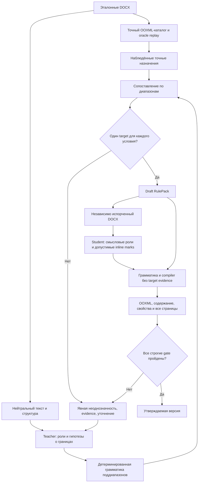
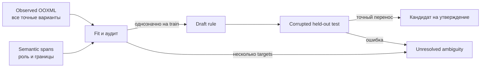

# ADR-011: иерархическая грамматика диапазонов и явная неоднозначность

Статус: **экспериментальный профиль; один синтетический held-out пройден с
LLM, перенос на реальный D не подтверждён**.
Дата: 18.10.2026. Уточняет
[ADR-005](005-explicit-format-variants.md) и
[ADR-007](007-context-rules-and-indices.md); не меняет их контроль точной
пересборки. Основание и измерения: [анализ серии036](../../research/span-grammar-036.md).

## Проблема

Пакет `catalogue-0.4` способен сохранить разные точные варианты OOXML и
воспроизвести исходный экземпляр. Но в `agent023` teacher главным образом
назначает абзацные роли и отдельные семантические inline-роли. Компилятор
пересекает эти диапазоны с наблюдаемыми целевыми стилями, а затем пытается
построить функцию `доступные признаки → один точный стиль`. В одном
семантическом диапазоне могут находиться несколько различных стилей. Когда
доступные признаки одинаковы, функция не существует: 17 из 28 символьных
конфликтных групп лучшего пакета D содержат разные стили внутри одного
семантического диапазона. Из 32 просмотренных смешанных диапазонов 31 получил
роль `plain`. Это ограничение представления границ и правил, а не свидетельство
о потере свойств парсером или принципиальной неспособности LLM.

Простое разбиение по классам Unicode увеличило долю покрытых смещений в
offline-подгонке на том же эталоне, но одновременно увеличило число
конфликтов. Поэтому его нельзя принять как готовое решение. Числа и
знаменатели приведены в исследовательском анализе.

## Решение для следующего экспериментального профиля

Предлагается три явно разделённых слоя:

1. **Наблюдения.** Парсер сохраняет точные `pPr/rPr` (включая свойства знака
   конца абзаца), стиль каждого текстового диапазона, структуру и ресурсы.
   Эти данные принадлежат закрытому training/evaluation evidence. Схлопывать
   похожие варианты или удалять неотрисовываемые различия нельзя.
2. **Грамматика смысловых диапазонов.** Teacher предлагает смысловые роли и
   правила нахождения поддиапазонов, различимых по тексту и нейтральной
   структуре нового документа. Детерминированный сегментатор выводит
   проверяемые границы по ограниченной грамматике: семантическое событие,
   класс токена, соседние классы, граница поля/формулы/ссылки, язык письма и
   структурная роль. Каждый используемый признак должен быть доступен на
   испорченном входе без знания целевой типографики. Универсальное деление
   каждого текста по Unicode-классу остаётся только baseline.
3. **Переносимые правила.** Компилятор сопоставляет каждый полученный
   поддиапазон наблюдённому точному варианту. Для одного набора runtime-
   признаков допускается один target; несколько targets образуют явный
   `ambiguity`, а не выбор большинства. Непокрытые смещения также остаются
   unresolved. Только проверенный полный пакет может получить статус ready.



### Расширенный контракт и экспериментальный поднабор

```json
{
  "schema_version": "span-grammar-draft-1",
  "input_protocol": "neutral_docx_without_source_typography",
  "offset_unit": "unicode_codepoint",
  "segmentation": {
    "semantic_roles": ["body", "term"],
    "allowed_content_features": ["token_class", "neighbor_class", "field_boundary", "script"],
    "boundaries": "deterministic_and_total"
  },
  "rules": [
    {
      "when": {"paragraph_role": "body", "inline_role": "term", "token_class": "letter"},
      "target_character_style": "catalogue-style-id",
      "evidence_count": 3,
      "state": "draft"
    }
  ],
  "ambiguities": [
    {
      "when": {"paragraph_role": "body", "inline_role": "plain"},
      "target_variants": ["catalogue-style-a", "catalogue-style-b"],
      "state": "requires_evidence"
    }
  ]
}
```

Это иллюстрация **расширенного** типа данных, не точная схема текущего
`TemplatePackage` и не правило, доказанное эталоном. Экспериментальный код
пока поддерживает более узкие selector-поля `role`, `inline_role` и
`character_class`; соседние классы, границы поля и script в примере остаются
проектом расширения. `target_character_style` выбирается только
после сопоставления с закрытыми наблюдениями; стиль не является условием
грамматики. Объект `ambiguities` принадлежит закрытому аудиту подготовки и
блокирует публикацию: student не получает список целевых вариантов для
угадывания. Runtime-пакет не содержит цитат, block ID, номера абзаца,
смещения диапазона из эталона и исходных target-назначений. Точные координаты
существуют у плана **нового** документа и проверяются по его содержанию.



## Инварианты и границы

- Грамматика вправе использовать смысл и нейтральную структуру; прямые
  шрифты, bold/italic, цвет, заливка, highlight, отступы или style ID
  испорченного входа не должны определять целевой стиль в строгом профиле.
  Их сохранение возможно только в отдельно объявленном source-aware режиме.
- Один target на обучении ещё не доказывает перенос: правило проверяется на
  документе с изменённым содержанием и независимо испорченной вёрсткой.
  Варианты corruption не формирует и не отбирает тот же teacher, который
  пишет правило. Данные контроля не входят в его контекст.
- Сегментация обязана покрыть все допустимые текстовые смещения ровно один
  раз, не терять формулы, поля, индексы и связи объектов, а перекрытия
  смысловых меток обрабатывать явным приоритетом либо отказом.
- Если одни и те же доступные runtime-признаки требуют разных точных
  вариантов, статус остаётся `needs_review`. Дополнительный эталон или ответ
  пользователя может уточнить условие, но сам по себе не делает правило
  доказанным: после изменения нужен новый полный цикл.
- Совпадение отрендеренных пикселей при фиксированных шрифтах и 144 DPI не
  тождественно равенству OOXML или свойств Word. Визуальная эквивалентность
  фиксируется отдельно, но не удаляет точные различия без изменения
  пользовательского критерия приёмки. Оценщик обязан отдельно проверять
  вычисленные свойства знака конца абзаца (`paragraph_marks_exact`): прежний
  контроль пропускал такую разницу даже при совпадающих пикселях.

## Альтернативы и проверка решения

«Взять самый частый стиль», скопировать style по block ID и использовать
типографику входа как hidden selector отклонены: они скрывают конфликт или
утекают из целевого оформления. Увеличение числа итераций teacher с той же
схемой не создаёт отсутствующие различающие признаки. Предложенная
грамматика также может оказаться недостаточной; критерием будет честный
неуспех на независимом тесте, а не подгонка train.

Контрольная [синтетическая family 037](../../../datasets/span-grammar-v037/README.md)
уже проверена **offline при oracle-ролях и oracle-inline-метках**: три эталона
по 44 абзаца дали 0 конфликтов и 43 правила; два независимо испорченных
входа нового документа дали 0 unresolved, точные содержание и свойства и
4/4 одинаковые страницы каждый. Отрицательный контроль дал четыре
символьных конфликта и отказ `SPAN_GRAMMAR_AMBIGUOUS`. Это проверяет
выразительность и gate, а не способность LLM вывести смысловые диапазоны.
На реальном сохранённом D opt-in grammar offline дала 92 конфликта
(7 абзацных, 83 символьных, 2 spacer) и 77 правил; улучшение переноса там
не показано.

Дополнительный oracle-held-out той же family имеет 56 абзацев, четыре раздела,
два рисунка и пять страниц. При истинных метках, без LLM-вызова, тот же fit
по трём эталонам (0 конфликтов, 43 правила) привёл независимо испорченный I1
к точным содержанию и свойствам, 0 unresolved и 5/5 одинаковым страницам.
Первый model-only вызов на этом более длинном контроле дал три unresolved
(два контекста тире в подписях и один конфликт порядка); точный документ
не получен. Повтор после исправления правил получил валидный план и 0
unresolved, но свойства и пиксели не совпали; 33 обычных абзаца получили
ложные отметки `defined_term`. Этот повтор показывает отдельную ошибку
назначения смысловых диапазонов даже при разрешённом компиляторе. После
настройки контроль относится к development, а не к нетронутому held-out.
Offline oracle-редактирование того же сохранённого student-ответа — удаление
33 ложных отметок и исправление одной роли заголовка — дало точные свойства
и 5/5 страниц без нового API-вызова. Это ограниченный контрфакт, не
автономное исправление и не второй успешный model trial.
Затем модельная абляция с внешним oracle-кандидатом, составленным из
истинных меток трёх синтетических эталонов, дала Qwen-3.8-27B точное
содержание, свойства и 5/5 страниц трудного I1 за один вызов. Это
показывает достаточность более различающих ролей в данном контроле, но
не подтверждает автономное извлечение такого шаблона: teacher здесь
заменён истинной разметкой, а hard I1 уже участвовал в диагностике.
Для отдельных опытов с внешней разметкой есть
[строгий offline-импорт](../external-semantic-import-037.md), который выдаёт
только черновой пакет и не является обходом проверки переноса.

Первый платный teacher/student-опыт на той же family уже завершён:
один GPT-6.1 Sol (`low`) создал пакет с 0 конфликтов, три Qwen-3.8-27B
вызова прошли 3/3 эталона, ещё один Qwen-вызов перенёс шаблон на новый
I1-вход с испорченными bold/italic, шрифтами, цветами и runs: 0 unresolved,
точное содержание и свойства, 4/4 одинаковые страницы. Всего 5 вызовов,
$0.111975625, 155.805 с; неизвестных расходов нет. Это измеренный перенос
на **один** новый документ той же контролируемой формы, не доказательство
работы на реальных произвольных DOCX или статистической устойчивости.
Дальнейшие опыты должны проверить несколько новых содержаний, иные family,
разные размеры student и реальный D при независимой порче.

[Экспериментальный runner](../../../scripts/experiment_hierarchy037.py)
фиксирует три разных reference, отдельную пару held-out input/golden,
hashes протокола и учёт попыток. Сводные измерения платного запуска
приведены выше; сырые ответы и индивидуальные артефакты хранятся закрыто.
