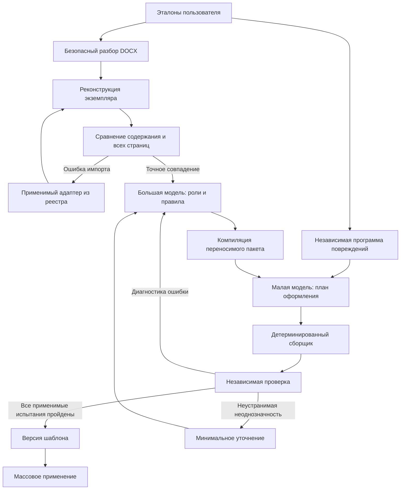

# Автономный контроллер шаблонов 028

Статус: экспериментальная реализация, а не доказанная поддержка любых DOCX.
Связанные требования: PRD-AGENT-028; реализация `agent028.py`, `agent023.py`,
`adapters028.py`, `webagent023.py`. Предыдущая [серия 027](../research/frozen-real-027.md)
остаётся замороженной; новые результаты нельзя приписывать старому коду.

## Контексты и границы ответственности

Большая модель не выбирает повреждения, не вычисляет метрику и не утверждает
собственный успех. Малая модель не получает oracle-план, целевое оформление
каждого блока или PDF эталона. Oracle доступен только проверяющему модулю.
Корруптор — обычный код с фиксированными правилами, не LLM. Это разделение
контекстов внутри процесса; отдельные защищённые вычислительные контейнеры
для каждой роли пока не реализованы.

## Импорт и доказательство полноты

Контейнер проверяется на размер, ZIP-пути/коэффициент сжатия, XML DTD, активное
содержимое. Приём безопасного контейнера в интерфейсе отделён от возможности
его воспроизведения. Неподдерживаемая конструкция не удаляется ради успеха.
Контроллер сначала восстанавливает экземпляр по полному каталогу и сравнивает
содержимое, размещение объектов, вложенную топологию, границы секций и все
растровые страницы в одной среде рендеринга.

Первый адаптер удаляет служебные отметки проверки орфографии и пустые runs.
Он работает на копии, фиксирует число изменений и проверяет fingerprint.
Возможное влияние пустых runs на вёрстку дополнительно проверяет пиксельный
контроль. Это ограниченный реестр адаптеров: агент не переписывает Python-код
сервера и не устанавливает зависимости по инструкциям из документа.

## Проверка переносимого пакета

После каждой гипотезы большая модель получает ошибки компиляции, неоднозначные
варианты и ошибки применения малой моделью. Невалидный ответ не исправляется
незаметно: следующая итерация является новым учтённым вызовом.

Сначала проверяется нейтрализованный документ. Затем контроллер самостоятельно
применяет ещё два испытания: другие шрифты/цвета/интервалы/отступы и перестановку
двух безопасных соседних абзацев. Секции, таблицы, рисунки, формулы, ссылки,
закладки и списки являются границами перестановки. Неприменимая перестановка
имеет статус `not_applicable`, а не «успех». Сейчас это небольшое семейство
повреждений, не исчерпывающее все способы испортить документ.

Успех исходного восстановления не даёт права выпустить шаблон. Для контракта
`adaptive-template-028` необходима отдельная сертификация стресс-проверок.
Она относится только к эталонам и применимым повреждениям. Новый документ
пользователя без целевого эталона проверяется структурно; пиксельную правильность
для него без цели объявлять нельзя.

## Конечность и измерения

Исследовательский запуск допускает до восьми итераций, отдельно учитывает
время и вызовы, использует единственный журнал расходов. Это предел данного
эксперимента, не найденное оптимальное число. Пользователь видит этап, время,
проблемы и результат; внутренние счётчики доступны в отчёте.

Измеряются: время до первой успешной сертификации; доля принятых шаблонов на
префиксах 1/2/3/5/8; стоимость; фактические API attempts; число обращений к
человеку; причины отказа импорта, невалидные ответы, неоднозначность и ошибки
рендера. Префиксы одной траектории не являются независимыми прогонами.
Непрошедшие документы остаются в знаменателе end-to-end оценки. Дополнительно
можно считать условную оценку только среди импортированных, явно называя её.

Бесконечный цикл не обещается. При исчерпании бюджета/времени сохраняется
диагностика, шаблон не становится готовым автоматически. Перед выбором
продуктового бюджета итераций нужны повторные запуски и независимая выборка.

## Веб и версии

`/templates`: список, создание из одного/нескольких эталонов, автоматический
запуск после разрешения внешней обработки, текущий этап и добровольное уточнение.
Режим `automatic` основной; `assisted` предусматривает подтверждение требований.
Исправление создаёт новый run, ранее утверждённый пакет не меняется на месте.
Замечание можно связать с заданием того же шаблона; принадлежность проверяет
сервер. Неучтённая поздняя обратная связь блокирует утверждение результата.

## Ограничения

Проверка по одному содержанию не доказывает обобщение на другие документы.
Неидентифицируемые различия оформления нельзя восстановить из текста без
правила выбора: сохраняем варианты и неопределённость. Несколько одинаковых
эталонов не создают такого правила автоматически. Плавающие объекты, текстовые
поля, сложные поля Word и некоторые другие конструкции ещё требуют поддержки.
