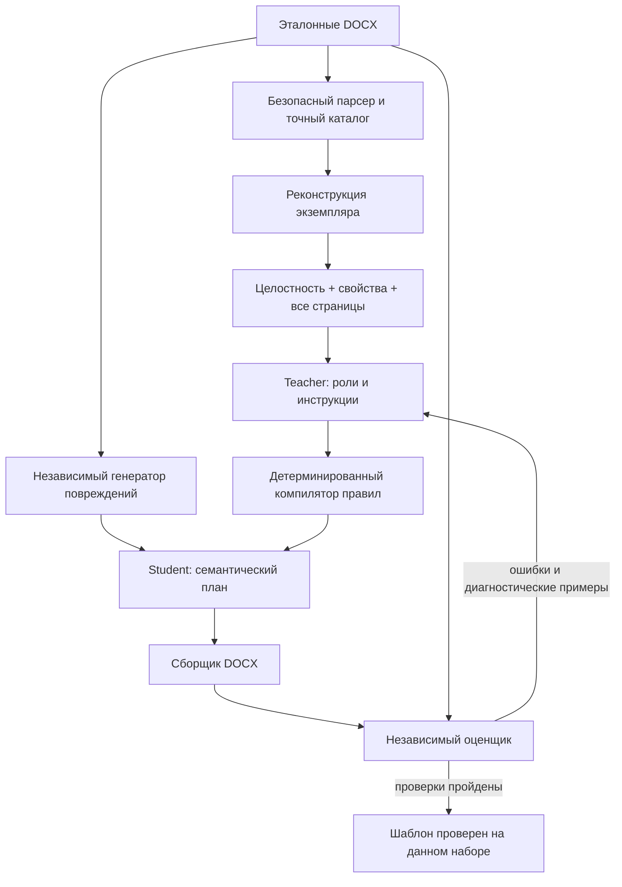

# Точные проверки и перестановка 032

Связано с PRD-AGENT-028. Новый контракт `adaptive-template-032` дополняет
пиксельное сравнение независимым аудитом эффективных свойств абзацев и
символьных диапазонов, таблиц, секций, SDT и рисунков. Проверяются также
ресурсы styles, numbering, settings, fontTable и theme. Свойства не округляются;
различие 1,25/1,27 см не объединяется. Сравнение не зависит от того, подменил ли
рендерер отсутствующий шрифт другим. Неиспользуемые ресурсы сравниваются строго,
поэтому аудит может отклонить визуально эквивалентный файл.

Проверка выполняется при реконструкции экземпляра, обычном применении и на
повреждённых копиях. Для утверждения нового шаблона веб-сервис требует
`format_properties_exact`, `instance_replay` и `stress_passed`. Старые отчёты028
читаются по старому контракту, без приписывания им новых проверок. Новая проверка
не сертифицирует неподдерживаемые возможности Word и идентичность между
разными движками рендеринга.

## Исправление защищённых границ

После введения control atoms в029 обычные переносы строк ошибочно запрещали
перестановку содержащих их абзацев. Кроме того, разрыв страницы запрещал
перемещение соседнего абзаца даже внутри одной страницы. Теперь текст,
обычный перенос и символ не блокируют перемещение. Разрыв страницы/колонки
остаётся неподвижной границей; объекты, ссылки и маркеры сохраняют защиту.
Генератор повреждений не переставляет абзацы с такими разрывами и не выдаёт
перестановку идентичных XML-абзацев за испытание.

Ошибка воспроизведена сохранёнными ответами реальных моделей: два документа
после исправления сборщика совпали по всем страницам без новых API-вызовов.
Это причинная диагностика ошибки компилятора, а не новые испытания LLM.
Свежие результаты публикуются отдельной серией032.

## Разделение доверия

Teacher не выбирает повреждения и не утверждает результат. Golden и oracle
не входят в runtime-пакет student. Текущие повреждения сохраняют семантические
выделения, структуру списков и объектов; это не восстановление из чистого текста.
