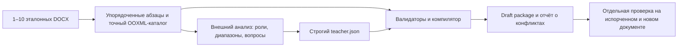

# Внешняя семантическая разметка: offline-импорт 037

Этот путь позволяет дать системе результат анализа эталонов, сделанный внешним
Codex или редактором, в том же структурированном контракте, что использует
teacher автономного цикла. Импортёр **не принимает прозу как шаблон**: текстовое
объяснение полезно для поиска ролей, исключений и вопросов, но из него нельзя
однозначно вычислить границы каждого диапазона и точные свойства всех знаков
нового DOCX. Для компиляции нужен полный JSON-план; точные варианты OOXML
компилятор считывает из эталонных файлов, а не из описания модели.



## Подготовка JSON

Сначала создайте **приватный пакет разметки** для внешнего Codex из тех же
эталонов и в том же порядке, которые затем передадите импортёру:

```bash
PYTHONPATH=src python scripts/export_semantic_packet037.py \
  /private/semantic-packet /private/reference-1.docx /private/reference-2.docx
```

Команда принимает 1–10 DOCX и **новый** выходной каталог. В нём
`packet.json` содержит `schema=external-semantic-packet-037`, сквозной список
`blocks` и `references`, где есть номер документа, диапазон глобальных
номеров, абсолютный путь `source_docx` и SHA-256 его байтов. Каждый блок
содержит `n` (1-based), `document`, `import_id`, точный нейтральный
`content_block` и `structure` с признаками содержания. Нумерация следует
конкатенации `content.blocks` в порядке файлов; в неё входят и пустые
абзацы, и абзацы таблиц, а абзац с рисунком нельзя считать пустым только
по тексту. Ключ `teacher_json_contract` напоминает нужные поля ответа.

`packet.json` не переносит каталог целевых стилей, oracle-план или исходные
шрифты/цвета/интервалы в role input. Для визуального изучения Codex должен
открыть **сами** DOCX по `source_docx`; ссылка не является снимком страницы и
не даёт доступ к файлу за пределами той среды, где он расположен. Экспортёр
локальный, вызовов модели не делает. Он публикует каталог атомарно с
правами 0700, `packet.json` с правами 0600 и `.gitignore` со значением `*`.
Пакет всё равно содержит текст частных документов и должен оставаться вне
публичного Git. Перед импортом используйте тот же порядок файлов и сверяйте
их SHA-256 с пакетом: сам импортёр не получает `packet.json` и не выполняет
эту сверку за вас.

Экспорт и импорт проверены шестью локальными тестами: в том числе реальным
циклом `export → teacher.json → import` и сравнением нейтрального role input
до и после I1-порчи исходной типографики. Это проверка границы данных и
команд, а не точности внешнего Codex на неизвестном документе.

Передайте внешнему Codex этот пакет и доступные ему эталонные DOCX. Для
каждого абзаца используйте именно поле `n` его элемента в `blocks` и
извлечённый текст,
а при необходимости — нейтральную структуру; нельзя нумеровать только
видимые строки из PDF. Исходные шрифты, цвета и отступы можно использовать
как *наблюдения на эталоне*, но они не становятся условиями выбора роли на
новом документе.

Краткая инструкция для внешнего Codex:

> Проанализируй предоставленные эталонные DOCX как документы одного вида.
> Верни **только один JSON-объект** ровно с ключами `roles`, `groups`,
> `inline_roles`, `inline`, `questions`. В `roles` назови переносимые
> смысловые роли абзацев и дай определения, распознаваемые по содержанию и
> структуре нового документа без исходной типографики. `groups` должны
> покрыть каждый абзац сквозной нумерации ровно один раз. В `inline_roles`
> определи смысловые роли фрагментов; в `inline` отметь все нужные точные
> неперекрывающиеся диапазоны. Привязывай диапазон к дословной цитате и её
> номеру появления в абзаце. Не определяй переносимое правило по номеру
> абзаца, имени автора, скопированной фразе, ID стиля, исходному bold/italic,
> цвету или положению на странице. Если одинаковый доступный контекст требует
> разных точных стилей и причину нельзя вывести, сохрани неоднозначность,
> задай только критичный вопрос в `questions`; не угадывай вариант. Не меняй
> содержание документа и не объявляй шаблон проверенным.

Точная схема верхнего уровня:

| Ключ | Тип и значение |
| --- | --- |
| `roles` | Объект от 1 до 80 пар `snake_case_id: определение` (3–600 символов). Роль должна быть распознаваема на другом документе. |
| `groups` | Массив `{start,end,role}`. `start` и `end` — включительные номера абзацев с 1; все абзацы покрыты ровно один раз, без пересечений; `role` объявлена в `roles`. |
| `inline_roles` | Объект до 40 пар `snake_case_id: определение` (3–600 символов). Пустой объект допустим; `plain` не объявляется. |
| `inline` | До 20 000 неперекрывающихся отметок. Предпочтительный вид: `{paragraph,quote,occurrence,role}` с дословной непустой цитатой и номером её появления с 1. Альтернатива: `{paragraph,start,end,role,quote}` с нулевыми Unicode-смещениями и исключающим `end`. |
| `questions` | До 20 объектов `{role,question}` для действительно невыводимых требований. `role` обязательно существует в `roles`; пустой список допустим. |

Идентификаторы ролей соответствуют `[a-z][a-z0-9_]{0,63}`. Цитата должна
**побуквенно** совпадать с извлечённым текстом указанного абзаца, включая
пробелы и знаки. Вариант `occurrence` полезен, когда не хочется вручную
считать Unicode-смещения, но номер появления при повторе цитаты тоже должен
быть точным. Немаркированный текст считается `plain`. Все пять верхних ключей
обязательны, даже если `inline_roles`, `inline` или `questions` пусты.

Это лишь схема на условных трёх абзацах; цитата и номера должны быть заменены
на реальные значения извлекателя перед импортом:

```json
{
  "roles": {
    "title": "Название всего документа",
    "body": "Основной пояснительный абзац"
  },
  "groups": [
    {"start": 1, "end": 1, "role": "title"},
    {"start": 2, "end": 3, "role": "body"}
  ],
  "inline_roles": {"defined_term": "Определяемый в этом месте термин"},
  "inline": [
    {"paragraph": 2, "quote": "термин", "occurrence": 1, "role": "defined_term"}
  ],
  "questions": []
}
```

## Импорт и смысл результата

Из корня репозитория, в локальном окружении с установленными зависимостями:

```bash
PYTHONPATH=src python -m articleflow import-semantic-template \
  /private/teacher.json /private/imported-template \
  /private/reference-1.docx /private/reference-2.docx --span-grammar
```

Аргументы идут в порядке `teacher_json`, **новый** выходной каталог, затем
1–10 эталонных DOCX. `--span-grammar` включает экспериментальный профиль
грамматики диапазонов; без флага используется обычная компиляция. Команда
локально извлекает каталоги и применяет те же валидаторы `groups`/`inline`,
что агентный teacher. Неправильная схема, пропущенный абзац, пересечение
диапазонов или неточная цитата прекращают импорт без публикации пакета.
Несовместимые ресурсы нескольких эталонов тоже могут заблокировать сборку.

Выход содержит `teacher.json` (точную копию входа), `report.json` и каталог
`template/` с черновым пакетом. `report.json` фиксирует число абзацев,
роли, вопросы и конфликтные группы. При конфликтах статус импорта
`needs_review`; при нуле конфликтов — `draft_compiled`. В обоих случаях
`template/semantic.json` остаётся `draft`, а сертификация явно
`not_evaluated_on_unseen_documents`. `model_calls: 0` означает лишь, что
**сам импортёр** не вызвал модель; внешний анализ Codex и его стоимость надо
учитывать отдельно.

Черновик нужно затем проверить как отдельный эксперимент: точный replay
эталонов, независимая порча оформления, новый документ с неизвестным
содержанием, student-план, сохранность объектов, свойства OOXML и все
страницы. Ноль обучающих конфликтов сам по себе не гарантирует перенос:
внешняя разметка может запомнить пример или пропустить смысловой диапазон.
Результат такого ассистированного импорта нельзя записывать как успех
**автономного** teacher. JSON, отчёт и собранный пакет могут содержать
частные сведения эталонов; не размещайте их в публичном репозитории.

Проверка самого пути импорта выполнена **offline на сохранённом ответе
модели** из прежнего автономного опыта 037. По трём синтетическим эталонам
(132 абзаца) получено 0 train-конфликтов; `semantic.json`, `rules.json` и
`resources.zip` побайтно совпали с пакетом внутреннего teacher. Повторное
применение ранее полученного Qwen-ответа к импортированному пакету дало
точные содержание и свойства и 4/4 одинаковые страницы. Это проверяет
эквивалентность двух путей компиляции для **того же** JSON и replay того же
student-плана. Это не второй независимый teacher/student-прогон, не новый
вызов внешнего Codex и не сертификация любого нового импортированного плана.

Для реального эталона отдельно импортирован сохранённый teacher JSON из
опыта, где модель получила приближённую прозу Codex. Импортёр извлёк 178
`content.blocks`, включая пустые и табличные абзацы, и подтвердил те же
43 конфликта (9 абзацных, 31 символьный, 3 spacer), что внутренний путь.
Статус остался `needs_review`; импорт не заменяет уточнение правила. Этот
offline replay не требовал новых модельных вызовов.

Методологическое разделение опытов: [methods.md](../research/methods.md),
контроль точности: [benchmark.md](../research/benchmark.md), экспериментальный
профиль: [ADR-011](adr/011-span-grammar-and-ambiguity.md).
