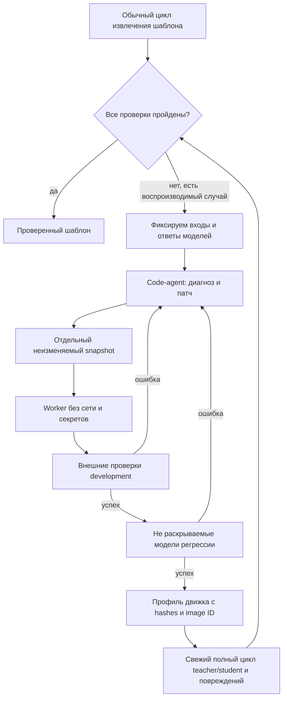

# Управляемое исправление движка034

PRD-AGENT-034 расширяет автономный цикл: при воспроизводимой программной ошибке
система может запросить у сильной модели изменение кода. Простое повторение
семантической разметки не является исправлением сборщика.

## Граница полномочий

Модель возвращает диагноз и точечные замены уникальных фрагментов Python.
Разрешены `catalogue.py`, `typography019.py`, `rules023.py`, `order024.py`.
Нельзя менять supervisor, API, тесты, генератор повреждений, оценщик содержания,
проверку свойств, визуальное сравнение и правила публикации. Проверка синтаксиса
не считается проверкой безопасности: предложенный код исполняется только в
контейнере, а не импортируется веб-процессом.

Контейнер: непривилегированный UID65534, без сети и capabilities, read-only root,
`no-new-privileges`, ограниченные память/CPU/число процессов и время операции.
Входы и snapshot движка монтируются read-only. Выход — ограниченный tmpfs,
из которого supervisor получает tar, проверяет пути, типы и размеры элементов,
запрещает ссылки и извлекает файлы самостоятельно. Ключи API, Git, домашний каталог,
Docker socket, golden и тестовые ожидания в worker не монтируются. API-вызовы
выполняет supervisor; worker получает уже проверенный семантический ответ.

Документы и сообщения моделей являются недоверенными данными. Изоляция уменьшает
последствия произвольного кода, но экспериментальный worker не заменяет полноценную
многопользовательскую инфраструктуру песочниц и её отдельный security-review.

## Два уровня цикла

`managed034.run` вызывается веб-приложением. При настроенном worker он собирает
replay-случаи из сохранённых ответов, добавляет независимые синтетические guards,
запускает repair и после принятия патча повторяет полный цикл. Код сервиса не
перезаписывается. Новая версия относится к конкретному шаблону; при массовом
применении используется тот же изолированный профиль. Hash mismatch блокирует
применение. Отказ или недоступность worker не превращается в сертификат.

Начальная реализация эскалирует после неуспешного обычного цикла. Автоматическая
политика раннего перехода по плато пока не реализована. Ошибки импорта без student-плана воспроизводятся отдельным instance-probe:
кандидат заново извлекает каталог и реконструирует экземпляр, внешний оценщик
проверяет результат. Поддержку произвольных Word-конструкций это не гарантирует:
неизменяемый внешний проверяющий также должен понимать соответствующий профиль. Это явные границы текущего среза.

## Проверки вне кандидата

Восстановленные файлы сравниваются с golden, который находится только у supervisor:
содержание/связи/структура, эффективные свойства и ресурсы, все страницы144DPI.
Самоотчёт candidate не используется как сертификат. В массовом применении без
golden supervisor независимо проверяет сохранность и допустимость перемещения.
Защищённая граница из доверенного контракта не отменяется патчем кандидата.

Regressions созданы отдельным генератором: перенос строки, соседство с разрывом
страницы, корректный порядок, запрещённый переход через страницу. Содержание
применяемого документа отличается от обучающего. Их признаки не выбирает code-agent.
Независимый генератор создаёт два диагностических и пять закрытых случаев.
Структурные факты диагностических случаев доступны в обратной связи; конкретные
ожидания закрытых случаев не раскрываются. Первоначальная абляция скрывала все
семь случаев и показала, что это мешает диагностировать соседство разрыва страницы.
Это небольшой набор, не доказательство общего отсутствия регрессий.

Оценка исправления движка использует фиксированные ответы student, чтобы измерять
эффект патча. Это не новые испытания классификации малой моделью. Fresh recheck
после принятия патча использует новые обращения teacher/student и учитывается отдельно.

## Диагностика

Первый опыт034 передавал только код ошибки и число нерешённых правил. Модель
обоснованно отказалась ослаблять защиту порядка без фактов о границе. В034b в
контекст development добавлены роли, типы атомов, атрибуты управляющих символов,
признаки секций/списков и конкретные условия `NO_RULE`. Для конфликтов обучения
передаются ограниченные примеры свойств. Содержимое sealed и его конкретные
ожидания не включаются в следующий запрос; сообщается только регрессия.

## Настройка

Собрать `deploy/repair-worker034.Dockerfile` с доверенным CA и настроить
`ARTICLEFLOW_REPAIR_IMAGE` для backend. При первом обращении tag разрешается в
неизменяемый image ID; профиль сохраняет именно ID. Приложение должно иметь доступ
к выделенному локальному Docker daemon. Не монтировать Docker socket в worker.
Отсутствие настройки означает обычный цикл без исполнения патчей.

Исследовательский запуск: `scripts/experiment_repair034.py --case order|inline|long`
с явными `--output`, `--artifacts`, `--key-file`, `--ledger`. Результаты сохраняются
в новом каталоге. Seed `order` восстанавливает историческую регрессию031;
`inline` использует компилятор032; `long` проверяет текущий оставшийся отказ.
Baseline, все неудачные патчи и новые запросы сохраняются; ничего не переписывается
задним числом в прежних сериях. Общий бюджет продолжает действовать.

## Накопление частичных улучшений034d

Кандидат, который уменьшает число конфликтов/неразрешённых случаев, не ухудшает
ни один development-случай и проходит все sealed guards, может стать **основой
следующего предложения**, но не выпускается пользователю. Каждая такая версия
сохраняется отдельно с `candidate_progress`. Если новый шаг не проходит проверки,
принятый основной сервис остаётся прежним. Окончательный профиль создаётся только
при прохождении всех случаев. Это эвристика выбора направления поиска, не
доказательство улучшения общей точности; меньший счётчик конфликтов сам по себе
не даёт сертификат. В модели нет права редактировать метрику или сам оценщик.

После каждого патча каталог и семантические признаки обучения извлекаются заново
из эталона. Использование старого извлечённого каталога допустимо только в явно
обозначенной исторической replay-абляции; иначе изменения парсера не участвуют
в проверке. Старые ответы teacher сохраняются как контроль; несовпадение числа
или текста блоков блокируется `CANDIDATE_TRAINING_ALIGNMENT` и требует новой
семантической разметки, а не переноса старых индексов на изменившуюся структуру.
