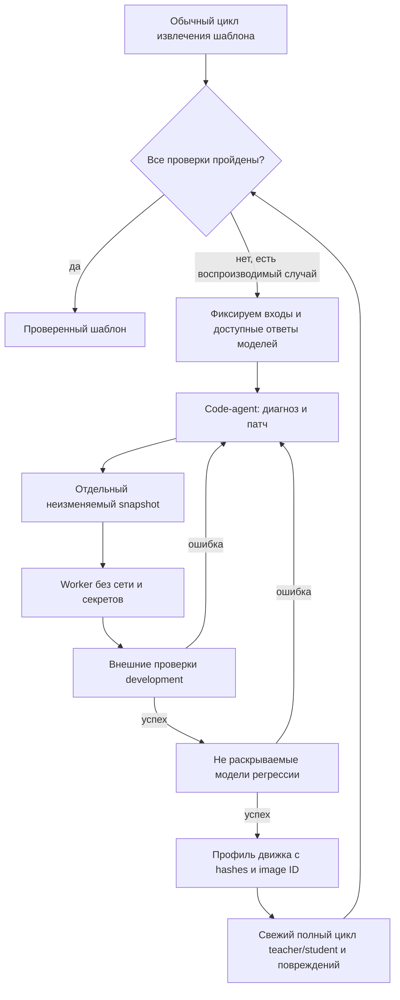

# Управляемое исправление движка034

PRD-AGENT-034 расширяет автономный цикл: при воспроизводимой программной ошибке
система может запросить у сильной модели изменение кода. Простое повторение
семантической разметки не является исправлением сборщика.

## Граница полномочий

Модель возвращает диагноз и точечные замены уникальных фрагментов Python.
Разрешены `catalogue.py`, `typography019.py`, `rules023.py`, `order024.py`.
Нельзя менять supervisor, API, тесты, генератор повреждений, оценщик содержания,
проверку свойств, визуальное сравнение и правила публикации. Проверка синтаксиса
не считается проверкой безопасности: предложенный код исполняется только в
контейнере, а не импортируется веб-процессом.

Контейнер: непривилегированный UID65534, без сети и capabilities, read-only root,
`no-new-privileges`, ограниченные память/CPU/число процессов и время операции.
Входы и snapshot движка монтируются read-only. Выход — ограниченный tmpfs,
из которого supervisor получает tar, проверяет пути, типы и размеры элементов,
запрещает ссылки и извлекает файлы самостоятельно. Ключи API, Git, домашний каталог,
Docker socket, golden и тестовые ожидания в worker не монтируются. API-вызовы
выполняет supervisor; worker получает уже проверенный семантический ответ.

Документы и сообщения моделей являются недоверенными данными. Изоляция уменьшает
последствия произвольного кода, но экспериментальный worker не заменяет полноценную
многопользовательскую инфраструктуру песочниц и её отдельный security-review.

## Два уровня цикла

`managed034.run` вызывается веб-приложением. При настроенном worker он собирает
replay-случаи из сохранённых ответов, добавляет независимые синтетические guards,
запускает repair и после принятия патча повторяет полный цикл. Код сервиса не
перезаписывается. Новая версия относится к конкретному шаблону; при массовом
применении используется тот же изолированный профиль. Hash mismatch блокирует
применение. Отказ или недоступность worker не превращается в сертификат.

Контроллер эскалирует после неуспешного обычного цикла; повтор той же эффективной
разметки и тех же конфликтов останавливает teacher раньше лимита итераций с
`SEMANTIC_PLATEAU`. Ошибки импорта без student-плана воспроизводятся отдельным instance-probe:
кандидат заново извлекает каталог и реконструирует экземпляр, внешний оценщик
проверяет результат. Если teacher уже вернул полную разметку, но конфликт при
построении правил остановил цикл до первого ответа student, создаётся
`training-only` probe. Если сохранён валидный ответ student, для fixed-response
replay берётся последняя завершённая попытка с ним. Без такого ответа выбирается
завершённая разметка teacher с минимальным числом проверенных конфликтов;
равенство разрешается в пользу более ранней итерации. Выбор использует только
development-данные, не подсматривая в закрытые guards. Выбранная разметка
остаётся неизменяемой на время replay: кандидат заново извлекает каждый эталон
и проверяет число конфликтов. При нуле
конфликтов собранный кандидатный шаблон воспроизводит каждый эталон с точными
проверками содержания, свойств и всех страниц. Ответ student для этого случая
не придумывается. Даже принятый по этим пробам патч не даёт готовый шаблон:
после него обязателен свежий полный цикл teacher/student и повреждений. Если
последняя попытка teacher была невалидна, она не становится training-case:
выбирается завершённая более ранняя разметка. Поддержку произвольных
Word-конструкций это не гарантирует: неизменяемый внешний проверяющий также
должен понимать соответствующий профиль. Это явные границы текущего среза.

## Проверки вне кандидата

Восстановленные файлы сравниваются с golden, который находится только у supervisor:
содержание/связи/структура, эффективные свойства и ресурсы, все страницы144DPI.
Самоотчёт candidate не используется как сертификат. В массовом применении без
golden supervisor независимо проверяет сохранность и допустимость перемещения.
Защищённая граница из доверенного контракта не отменяется патчем кандидата.

Regressions созданы отдельным генератором: перенос строки, соседство с разрывом
страницы, корректный порядок, запрещённый переход через страницу. Содержание
применяемого документа отличается от обучающего. Их признаки не выбирает code-agent.
Независимый генератор создаёт два диагностических и пять закрытых случаев.
Структурные факты диагностических случаев доступны в обратной связи; конкретные
ожидания закрытых случаев не раскрываются. Первоначальная абляция скрывала все
семь случаев и показала, что это мешает диагностировать соседство разрыва страницы.
Это небольшой набор, не доказательство общего отсутствия регрессий.

Если ответы student уже были, оценка исправления движка использует их фиксированные
версии, чтобы измерять эффект патча. `training-only` применяется исключительно
до первого доступного ответа student; он проверяет только компиляцию и точное
воспроизведение известных экземпляров. Это не испытания классификации малой
моделью. Fresh recheck после принятия патча использует новые обращения
teacher/student и учитывается отдельно.

## Диагностика

Первый опыт034 передавал только код ошибки и число нерешённых правил. Модель
обоснованно отказалась ослаблять защиту порядка без фактов о границе. В034b в
контекст development добавлены роли, типы атомов, атрибуты управляющих символов,
признаки секций/списков и конкретные условия `NO_RULE`. Для конфликтов обучения
передаются ограниченные примеры свойств. Содержимое sealed и его конкретные
ожидания не включаются в следующий запрос; сообщается только регрессия.

## Настройка

Собрать `deploy/repair-worker034.Dockerfile` с доверенным CA и настроить
`ARTICLEFLOW_REPAIR_IMAGE` для backend. При первом обращении tag разрешается в
неизменяемый image ID; профиль сохраняет именно ID. Приложение должно иметь доступ
к выделенному локальному Docker daemon. Не монтировать Docker socket в worker.
Отсутствие настройки означает обычный цикл без исполнения патчей.

Исследовательский запуск: `scripts/experiment_repair034.py --case order|inline|long`
с явными `--output`, `--artifacts`, `--key-file`, `--ledger`. Результаты сохраняются
в новом каталоге. Seed `order` восстанавливает историческую регрессию031;
`inline` использует компилятор032; `long` проверяет текущий оставшийся отказ.
Baseline, все неудачные патчи и новые запросы сохраняются; ничего не переписывается
задним числом в прежних сериях. Общий бюджет продолжает действовать.

## Накопление частичных улучшений034d

Кандидат, который уменьшает число конфликтов/неразрешённых случаев, не ухудшает
ни один development-случай, проходит точную реконструкцию и проверку устойчивости
к изменению исходной вёрстки, а затем все sealed guards, может стать **основой
следующего предложения**, но не выпускается пользователю. Каждая такая версия
сохраняется отдельно с `candidate_progress`. Если новый шаг не проходит проверки,
принятый основной сервис остаётся прежним. Окончательный профиль создаётся только
при прохождении всех случаев. Это эвристика выбора направления поиска, не
доказательство улучшения общей точности; меньший счётчик конфликтов сам по себе
не даёт сертификат. В модели нет права редактировать метрику или сам оценщик.

Для частичного кандидата дополнительно выполняется `source_gate`: его собственный
парсер извлекает все обучающие эталоны заново, компилятор строит пакет из
замороженных назначений teacher, а сборщик реконструирует каждый экземпляр.
Отдельно запускаются правила полученного пакета на тех же замороженных метках:
считаются неразрешённые решения, а полный план стилей сравнивается с планом,
извлечённым из эталона. Точный replay через готовый `oracle-plan.json` сам по
себе не подтверждает пригодность `semantic.json` для нового документа: пакет
с пустыми правилами тоже способен пройти такой replay. При нуле конфликтов
требуется точное совпадение всех решений; при частичном улучшении число
неразрешённых решений не может увеличиться, а неверный выбранный стиль не
проходит `source_gate`.
Внешний оценщик проверяет научное содержание и связи, точные свойства и все
страницы. Уменьшение числа конфликтов ценой удаления свойств либо ухудшения
исходного replay отклоняется с `SOURCE_INSTANCE_REGRESSION` ещё до использования
кандидата на следующем шаге. Успех этого дополнительного gate по-прежнему не
является доказательством переноса на новые документы и не отменяет свежий
цикл teacher/student после полного принятия патча.

### Gate устойчивости исходных признаков036

Опыт с реальным эталоном показал недостаточность точной реконструкции самого
источника: code-agent мог уменьшать число конфликтов, добавляя селекторы цвета,
заливки и подсветки **входного** текста. Такие признаки могут исчезнуть при
перевёрстке; исходный `source_gate` и прежние пять закрытых случаев этого не
обнаружили.

Теперь после `source_gate`, до скрытых регрессий, внешний supervisor создаёт
две независимо и заранее определённо испорченные копии каждого обучающего
DOCX. Меняются прямые шрифт, размер, цвет, заливка, подсветка, интервалы,
отступы и выделения; текст, структура и размещение объектов должны остаться
неизменными. На оригинале и копиях замораживаются метки teacher и inline
аннотации. Внешняя проверка сравнивает три уровня поведения старого и нового
движка: чувствительность селекторов, выбранные цели правил по символам и
фактические решения `order`/`spacers`/`compile_plan` в изолированном worker.
Соседние интервалы с одинаковым итоговым стилем считаются одним решением.
Кандидат не может добавить зависимость итогового стиля от испорченного
входного оформления по сравнению с базовым движком. Нарушение даёт
`TYPOGRAPHY_LEAKAGE`: кандидат отклоняется до закрытых случаев и не получает
профиль. Существующая в базовом шаблоне зависимость от смыслового `bold` сама
по себе не блокирует кандидата. Новая зависимость от входного `bold` может
быть отвергнута: для проверки произвольно испорченной вёрстки этот признак
считается нестабильным, даже если автор намеревался использовать его как
смысловой сигнал. Проверка использует агрегаты и отпечатки решений без
ответов закрытых случаев. Два варианта порчи не доказывают устойчивость ко
всем допустимым входам. Операция `compile` исполняется из неизменяемого
snapshot кода, смонтированного в `/engine`; образ worker из
`deploy/repair-worker034.Dockerfile` требуется пересобирать при изменении
его зависимостей, а не только из-за добавления этой операции.

Новый gate ретроспективно проверил оба сохранённых частичных патча серии036.
Первый отклонён по `color` и `shading`, второй также по `highlight`: на двух
копиях каждый из этих селекторов изменился в 67 392 из 67 392 символьных
наблюдений. Это **offline-проверка прежних артефактов прежним уровнем gate**,
без LLM-вызова. Исторические пакеты не проходят нынешнюю валидацию правил
(`RULE_SELECTOR_FORBIDDEN`); фактическую компиляцию этих двух патчей новым
worker повторно не проверяли.
Прежние записи о прохождении 5/5 закрытых проверок остаются историческими
фактами; по нынешнему контракту оба патча отвергаются до них. Контроли
`tests/test_repair034.py` покрывают отклонение и отсутствие передачи закрытых
данных в модель.

После каждого патча каталог и семантические признаки обучения извлекаются заново
из эталона. Использование старого извлечённого каталога допустимо только в явно
обозначенной исторической replay-абляции; иначе изменения парсера не участвуют
в проверке. Старые ответы teacher сохраняются как контроль; несовпадение числа
или текста блоков блокируется `CANDIDATE_TRAINING_ALIGNMENT` и требует новой
семантической разметки, а не переноса старых индексов на изменившуюся структуру.
