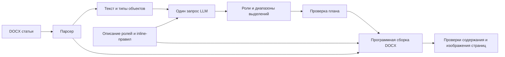

# Исследовательский прототип 0.3

Реализован локальный CLI для одного образца, извлечения наблюдений, сборки DOCX, проверки содержимого и измеренных вызовов OpenRouter. Это срез требований PRD-001, PRD-005, PRD-013–015 и PRD-017. Web, очереди, ZIP для сотен статей и универсальный extractor остаются спецификацией. Фактические результаты: [pilot-001](../research/pilot-001.md).

## Три разных проверки

| Контур | Что получает сборщик | Что проверяем |
| --- | --- | --- |
| Instance lossless | Исходное содержимое, все исходные XML-свойства и их точные назначения | Можно ли разобрать и собрать этот экземпляр без изменения |
| Role oracle | Общие параметры ролей, заранее известные роли и исходные inline spans | Достаточен ли текущий общий шаблон при правильной разметке |
| Role model | Тот же шаблон, роли и spans из одного ответа модели | Каковы дополнительные ошибки модели |

Instance lossless **не является переносимым шаблоном**. Его успех не измеряет LLM. Oracle — контрольная подсказка оценщику, её нельзя передавать student. Текущий role renderer сохраняет геометрию таблиц и изображений и ресурсы стилей исходного файла; поэтому оба role-контура — диагностический гибрид, а не строгий I1. Даже идеальный результат здесь не получает `strict_I1_pass=true`.

## Извлечение и хранение

`inspect` раскрывает DOCX как OPC/ZIP, проверяет лимиты, XML, активные и неподдерживаемые конструкции. Содержимое главной части разбирается на абзацы, обычный текст, гиперссылки, рисунки и OMML. Текст соседних runs объединяется, IDs стабильны в пределах конкретного извлечения.

Папка извлечения приватная:

```text
content/
  content.json       # блоки, текст, типы и IDs объектов; без исходных spans
  evidence.json      # исходные pPr/rPr, runs, spans, свойства секции
  inventory.json     # количества и ограничения
  skeleton.xml       # порядок блоков и исходная геометрия таблиц
  support.docx       # прочие части исходного OPC-пакета
  objects/*.xml      # исходные рисунки/формулы, включая геометрию
```

Исследователь читает evidence и вид документа, задаёт смысловые роли и наблюдаемые inline-правила. `build-template` группирует абзацы по ручной разметке. Для роли выбирается наиболее частый `pPr`; базовый `rPr` выбирается по суммарной длине содержащего его текста. Сохраняется число вариантов, чтобы конфликт не исчезал из отчёта. При равной частоте выбирается первый встреченный вариант. Это исходный baseline, а не доказательство правильности самого частого оформления.

В `rules.json` хранятся `schema_version=pilot-0.3`, `status=research_draft`, метод получения, роли с описаниями и исходными XML-свойствами, параметры секции, inline-правила и ограничения. Точная запись XML сохраняет единицы OOXML, но пока не заменяет полноценное разрешение наследования стилей. Ресурсы `styles.xml`, themes и fonts необходимы отдельно. Одного `rules.json` недостаточно для автономного переноса на произвольный DOCX.

Этот формат не заменяет нормативные [TemplatePackage v0.2](template-package.md) и [DocumentPlan v0.2](document-plan.md). Он имеет отдельную версию; автоматической миграции и продуктовой совместимости пока нет. Упаковка приватного образца не превращает его в утверждённый шаблон.

## Применение за один запрос



Модель получает все 178 блоков целиком, смысловые описания ролей, inline-правила и типы объектов. Ни правильные роли конкретных блоков, ни исходные выделения, ни golden PDF ей не передаются. Числовые параметры оформления применяет renderer по ID роли. На стороне renderer ограничения гибрида сохраняются и явно записаны в метриках.

Модель возвращает только `blocks[{id, role, spans}]`; каждый span содержит `start`, `end`, `bold`, `italic`, `vertical`. Смещения — Unicode code points, полуинтервал `[start,end)`. `null` означает отсутствие переопределения. Генерировать научный текст заново не требуется. Валидатор требует точного покрытия IDs, известных ролей, корректных границ и отсутствия пересечений. Исходный порядок берётся из content/skeleton. Проверка границ combining characters и ZWJ частичная, не полный Unicode grapheme segmenter.

`render` создаёт новые текстовые runs, применяет свойства роли и spans, сохраняет текст/табуляции/разрывы строк, возвращает непрозрачные объекты. Изменения переноса строк и размера текста могут менять страницы даже при сохранении всех букв.

## Ограничения текущего парсера и evaluator

- Поддержан исследованный профиль Transitional OOXML: обычный текст, inline drawings, OMML, простые таблицы. Макросы, embedded OLE, tracked changes, textboxes, floating anchors, поля и ссылки на сноски отклоняются соответствующим этапом. Нет заявления о поддержке произвольного Word.
- Ресурсы и вспомогательные части исходника сохраняются. Нельзя считать это нейтральным renderer или безопасным сервисом загрузки публичных документов. Headless LibreOffice запускается для доверенного пилота, production sandbox и очистка внешних связей ещё нужны.
- Содержимое проверяется по точному тексту, табуляциям, разрывам, структуре OMML, ячейкам/merge, байтам media, гиперссылкам, relationships и note parts. Верхние/нижние индексы проверяются отдельно как защищённая семантика.
- Обычные bold/italic оцениваются отдельно. Для этого есть ограниченный resolver default/paragraph/character styles и direct flags. Он не реализует всю каскадную модель Word, условные table styles, все complex-script свойства и все объекты. `content_exact` имеет указанную область проверки, а не является универсальным доказательством целостности DOCX.
- Рисунки и подписи пока не формируют полноценный граф bindings. В образце обнаружены двуязычные подписи и группа из трёх панелей внутри таблицы. Следующий контракт должен поддержать несколько языковых подписей у figure group и вложенные panel labels; молча сводить их к одной подписи нельзя.

## OpenRouter и воспроизводимость

Основная актуальная серия использует `openai/gpt-6.1-sol` (выпуск 2026-09-29), reasoning medium без temperature, `max_tokens=14000` включая reasoning, JSON Schema strict, один HTTP POST, `allow_fallbacks=false`, без application cache и repair. Старый GPT-4.1 с temperature=0 остаётся только историческим baseline. Допуск новых кандидатов после июня 2026 проверяется по [registry](../research/models.json) до платного запроса; [источники дат и бюджет](../research/model-selection.md). Это API alias, а не закреплённые веса; resolved model и provider записываются. Кэш входного prompt у провайдера учитывается отдельно и не означает повторное использование ответа.

Перед запросом резервируется верхняя оценка стоимости для выбранных текстовых маршрутов OpenAI; общий max_tokens ограничивает reasoning и ответ, затем сохраняется реальный `usage.cost`. Если стоимость неизвестна, резерв не освобождается. Лимит первого исследования — 5 USD. Ledger последовательный, файловый, без межпроцессных блокировок: запускать один процесс на общую папку результатов. Создание другой папки создаёт другой ledger; для новой серии нужно явно учитывать уже потраченный бюджет. Для произвольных других провайдеров, тарифных уровней и дополнительных fees эта оценка ещё не сертифицирована. Проверенный профиль не использует tools, batch и дополнительные сервисы.

Все requests/responses, планы и неуспешные DOCX остаются в игнорируемой приватной папке. Исследователь может изучить неуспешный файл, но он не считается принятым продуктовым результатом. Публичная таблица содержит только разрешённые числовые поля и hashes.

## Команды

```bash
python -m pip install -e '.[dev]'
articleflow inspect private-fixtures/pilot-001/source.docx artifacts/pilot-001/content
articleflow build-template artifacts/pilot-001/content private-fixtures/pilot-001/annotations.json private-fixtures/pilot-001/definitions.json artifacts/pilot-001/template/rules.json
articleflow lossless-split private-fixtures/pilot-001/source.docx artifacts/pilot-001/instance
articleflow lossless-rebuild artifacts/pilot-001/instance artifacts/pilot-001/rebuilt.docx
articleflow pdf artifacts/pilot-001/rebuilt.docx artifacts/pilot-001/rebuilt-pdf
articleflow environment
python -m unittest discover -s tests -v
behave docs/product/scenarios/research-pilot.feature
```

`annotations.json` — объект `block_id: role_id`; `definitions.json` — объект с `roles: {role_id: описание}` и `inline_rules: [правило]`. Эти файлы создаёт исследователь, а не скрытая эвристика по порядковым номерам статьи. Для новых статей исходная ручная разметка служит только оценке и не передаётся модели.

```bash
articleflow trials \
  --content-dir artifacts/pilot-001/content \
  --template artifacts/pilot-001/template/rules.json \
  --oracle artifacts/pilot-001/oracle-role-plan.json \
  --source private-fixtures/pilot-001/source.docx \
  --golden-pdf artifacts/pilot-001/golden/source.pdf \
  --catalogue artifacts/pilot-001/models-catalog-current.json \
  --output artifacts/pilot-001/trials \
  --model openai/gpt-6.1-sol --repeats 10 --cap-usd 5 \
  --model-registry docs/research/models.json --reasoning-effort medium
```

Ключ читается из `OPENROUTER_API_KEY` или приватного `--key-file`; не вставлять его в команду, Git или документацию. Модельные тесты платные и запускаются только этой отдельной командой. `soffice` и fontconfig нужны для PDF; [requirements-pilot.txt](../../requirements-pilot.txt) фиксирует Python-пакеты измеренного стенда, а полный font/engine manifest сохраняется с результатом. Системные шрифты и сборка LibreOffice отдельно не устанавливаются pip.
