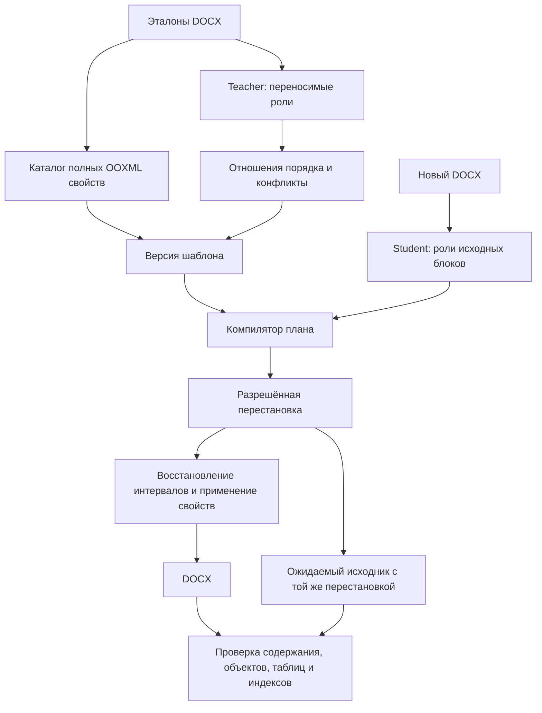

# Перенос порядка смысловых блоков, 024

Требования PRD-005, PRD-010, PRD-013, PRD-029. Реализация:
`src/articleflow/order024.py`, интеграция `agent023.apply/build_package`.

## Контракт

Из размеченных эталонов извлекаются отношения `before → after` между ролями.
В пакет входят названия ролей и число наблюдений, без текста, block IDs или
номеров абзацев эталона. Смежные абзацы одной роли образуют группу.
Повторяющиеся несмежные роли исключаются из глобального порядка: сортировать
все заголовки перед всем основным текстом было бы ошибкой.
Противоречащие образцы и циклы блокируют проверку пакета; majority fallback нет.
Наличие роли в образце не делает её обязательной.

## Безопасность преобразования

Стабильная топологическая сортировка действует на непрерывные группы обычных
текстовых абзацев. Таблицы, рисунки, формулы, маркеры, гиперссылки, пустые абзацы,
нумерация (включая наследуемую из стиля) и несмежные повторения роли — границы.
Если требуемое отношение нельзя выполнить без пересечения границы, результат
остаётся `needs_review`, код `ORDER_PROTECTED_BOUNDARY`; успешный DOCX не выдаётся.
Это ограничение реализации, а не заявление о поддержке произвольной перестановки.

Отчёт содержит `structure_permutation` и `structure_moves` с исходными IDs,
ролью и старой/новой позицией. Перестановка обязана быть биекцией. Контрольный
DOCX строится из входного документа только перестановкой соответствующих узлов;
с ним сравнивается результат сборки. Таким образом прежний ordered fingerprint
не ослабляется до подсчёта слов или неупорядоченного множества абзацев.

Порядок применяется **до** восстановления пустых интервалов и выбора правил
оформления, чтобы контекст `previous_role/next_role` относился к целевой структуре.
Исторические пакеты без `order` сохраняют прежнее поведение. Новые пакеты
получают `order.schema=role-order-024`; переобучение необходимо для миграции.

## Граница доказанного

Тесты проверяют независимый текст, повреждённый порядок, сохранность payload,
обнаружение последующей подмены текста, конфликт эталонов, повторяемые разделы,
отказ при переходе через таблицу и невозможность небиективной перестановки.
Это тесты компилятора с известными ролями, не новые испытания LLM.
Для разделения смысловых фрагментов одного абзаца и переноса связанных групп
рисунок–подпись необходим отдельный контракт; этот срез его не подменяет.
