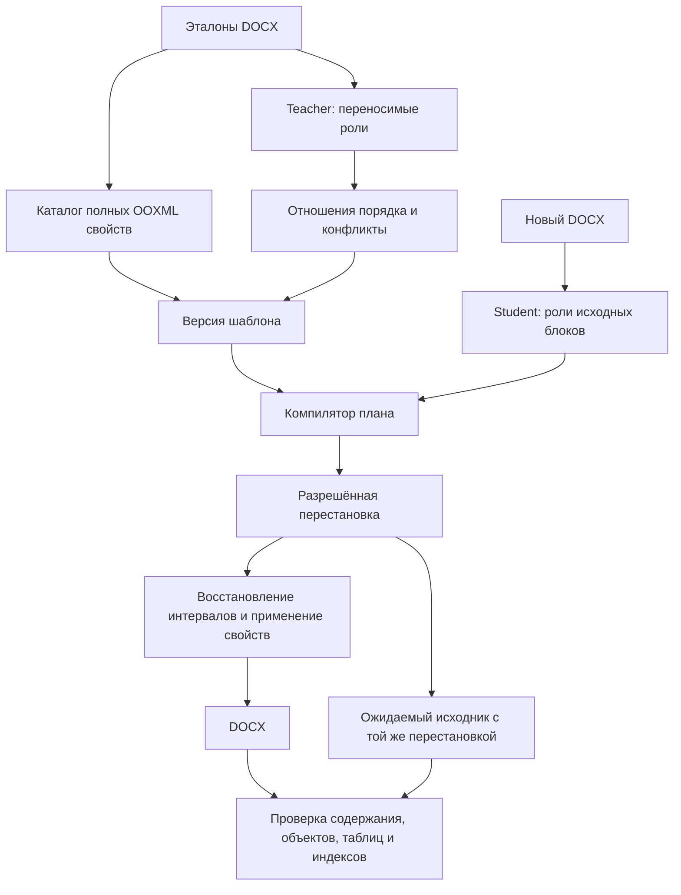

# Перенос порядка смысловых блоков, 024

Требования PRD-005, PRD-010, PRD-013, PRD-029. Реализация:
`src/articleflow/order024.py`, интеграция `agent023.apply/build_package`.

## Контракт

Из размеченных эталонов извлекаются отношения `before → after` между ролями.
В пакет входят названия ролей и число наблюдений, без текста, block IDs или
номеров абзацев эталона. Смежные абзацы одной роли образуют группу.
Повторяющиеся несмежные роли исключаются из глобального порядка: сортировать
все заголовки перед всем основным текстом было бы ошибкой.
Противоречащие образцы и циклы блокируют проверку пакета; majority fallback нет.
Наличие роли в образце не делает её обязательной.

## Безопасность преобразования

Стабильная топологическая сортировка действует на непрерывные группы обычных
текстовых абзацев. Таблицы, рисунки, формулы, маркеры, гиперссылки, пустые абзацы,
нумерация (включая наследуемую из стиля) и несмежные повторения роли — границы.
Если требуемое отношение нельзя выполнить без пересечения границы, результат
остаётся `needs_review`, код `ORDER_PROTECTED_BOUNDARY`; успешный DOCX не выдаётся.
Это ограничение реализации, а не заявление о поддержке произвольной перестановки.

Отчёт содержит `structure_permutation` и `structure_moves` с исходными IDs,
ролью и старой/новой позицией. Перестановка обязана быть биекцией. Контрольный
DOCX строится из входного документа только перестановкой соответствующих узлов;
с ним сравнивается результат сборки. Таким образом прежний ordered fingerprint
не ослабляется до подсчёта слов или неупорядоченного множества абзацев.

Порядок применяется **до** восстановления пустых интервалов и выбора правил
оформления, чтобы контекст `previous_role/next_role` относился к целевой структуре.
Исторические пакеты без `order` сохраняют прежнее поведение. Новые пакеты
получают `order.schema=role-order-024`; переобучение необходимо для миграции.

## Граница доказанного

Тесты проверяют независимый текст, повреждённый порядок, сохранность payload,
обнаружение последующей подмены текста, конфликт эталонов, повторяемые разделы,
отказ при переходе через таблицу и невозможность небиективной перестановки.
Это тесты компилятора с известными ролями, не новые испытания LLM.
Для разделения смысловых фрагментов одного абзаца и переноса связанных групп
рисунок–подпись необходим отдельный контракт; этот срез его не подменяет.

## Режимы извлечения и обратная связь

`POST /templates/{id}/learn`: `mode=automatic` по умолчанию либо `assisted`.
Автоматический режим после reference_verified и отрицательных контролей создаёт
новую неизменяемую версию без обязательного ответа на вопросы о наличии блоков.
Неустановленная обязательность остаётся неизвестной: пропуски наблюдавшихся ролей
показываются в отчёте; лишь явно установленные required_roles блокируют готовность.
В assisted ответы на вопросы остаются обязательными перед сохранением версии.
Старые версии без mode продолжают прежнюю политику review.

`POST /template-runs/{id}/feedback` принимает полный текст актуального уточнения
и `expected_revision`; optimistic concurrency защищает от потери чужой правки.
SQLite-таблица `learning_feedback024` хранит текущую версию. Исходные запросы
итераций сохраняют фактически применённый текст в закрытых журналах провайдера.
Уточнение читается перед следующей итерацией, не прерывает запрос и не запускает
скрытый дополнительный платный вызов. Применённая версия записана в отчёте.
После завершения новые уточнения требуют нового запуска. Если уточнение получено,
но не применено, сохранение шаблона блокируется; интерфейс не обещает обратного.

Стадии: extracting → teacher → compiling → student → comparing → negative_controls
→ finished. Они публикуются в существующем API run report и отображаются в UI.
Проверенный этап не означает полного универсального покрытия DOCX.

Диагностика конфликтов (`diagnostics024.py`) показывает различающиеся пути
свойств OOXML для наблюдаемых вариантов. Варианты не сливаются на основании
этого списка; эквивалентность остаётся `not_established`. Диагностика передаётся
teacher в существующей обратной связи и доступна в интерфейсе. Если набор
примеров усечён, `diagnostic_complete=false` не позволяет считать список полным.
Непосредственные соседи объектов также защищены от движения как потенциальные
подписи; отсутствие установленного binding не превращается в разрешение их отрывать.

Воспроизводимая настройка шрифтов описана в [профиле шрифтов](font-profile-024.md).

Отдельный [контролируемый эксперимент](equivalence-probe-024.md) позволяет
проверять визуальную эквивалентность конфликтующих свойств без изменения
production-пакета и без выдачи oracle-контроля за модельный перенос.

### Точная сохранность вариантов и адреса конфликтов

Политика `preserve_exact_differences`: даже визуально эквивалентные варианты
не нормализуются автоматически. Необъяснённые различия требуют уточнения
семантического условия; порядок большинства или номер исходного абзаца
не становятся правилом выбора. Диагностический отчёт итерации содержит
`conflict_evidence`: до 50 групп, документ (с единицы), порядковый номер
абзаца в извлечённом списке, block ID, диапазон символов [start,end)
и фрагмент до 240 символов. Это частные данные запуска, не runtime-пакет.
Номера документов различают одинаковые block IDs из разных эталонов.
Показан один пример каждого доступного варианта; неполнота отмечается явно.
PDF открывается целиком: координаты и номера страниц не выдумываются.
Для конфликтов границ и элементов без найденного абзаца UI прямо сообщает
о неполной локализации. Тест: `test_diagnostics024.py`.
