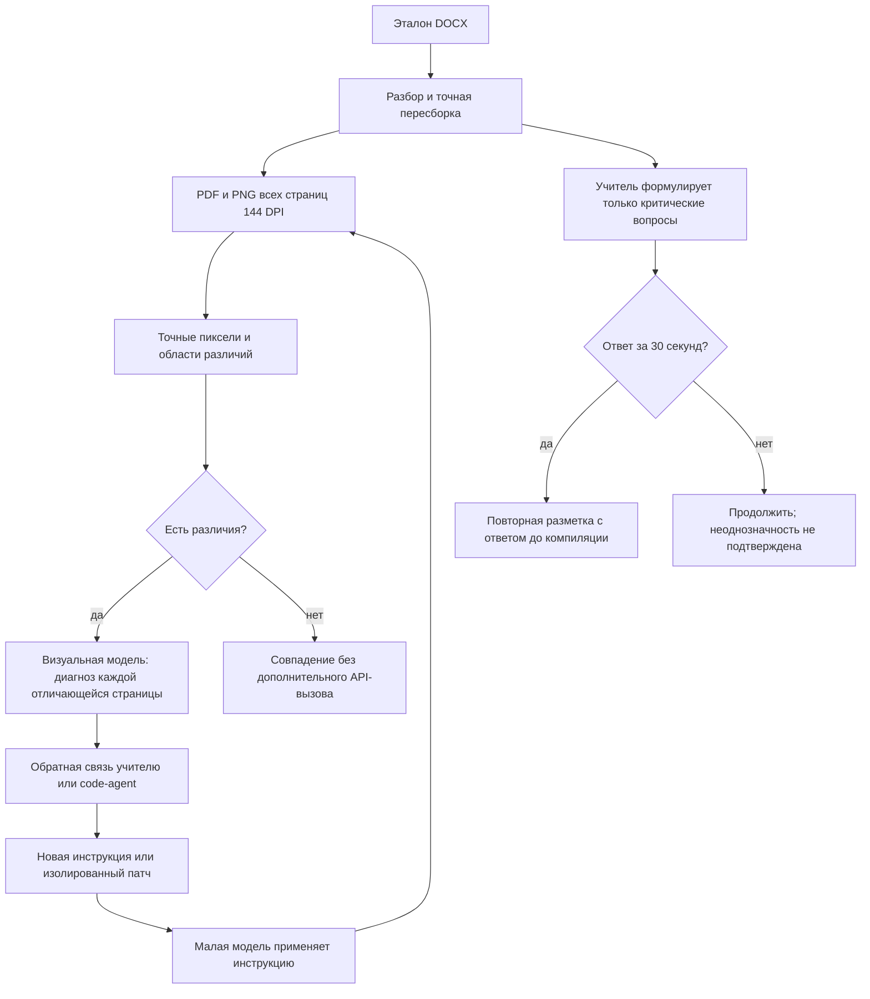

# Визуальный цикл и необязательные вопросы035

Связь: PRD-AGENT-035. Не заменяет [управляемый ремонт034](managed-repair-034.md).

`visual035.inspect` получает два PDF и создаёт PNG для всех страниц обоих файлов,
разностное изображение для одинаковых размеров, bounding box отличий, явный
PAGE_MISSING/PAGE_SIZE. Сравнение не ограничивается min(page_count). Для каждой
отличающейся страницы отправляет пару JPEG720px в модель через существующий
budgeted caller. Оригинальные PNG144DPI остаются на диске. Это ограничивает
разрешение модельного зрения, но не разрешение независимой пиксельной проверки.
Запросы не скрыты, учитываются в общем лимите/ledger. Ошибка зрения сохраняется
как diagnosis_error и не изменяет критерии совпадения. Закрытые regression cases
code-agent не видит. Визуальный диагноз нельзя считать доказательством корректности.

Модуль встроен в preflight, обычное применение, restyled/permuted stress и
разбор development-проб ремонта. Визуальные результаты передаются следующему
teacher/code-agent. При отсутствии собранного PDF визуальный диагноз невозможен;
используется структурная диагностика. Самостоятельные вызовы Qwen уже выполняются
в agent023.apply и в стресс-проверке каждой итерации. После принятия патча034
запускает свежий цикл teacher/student; новые визуальные проверки действуют и там.

Флаг teacher.visual_review включён в web backend. CLI может включить явно.
Для диагноза `visual035.inspect` берёт `teacher.visual_model`, если он задан:
меняется только ID модели; ключ, ledger и остальные ограничения вызова остаются
общими с teacher. Web backend по умолчанию выбирает
`inclusionai/ling-3.0-flash-vl` для visual, сохраняя
`openai/gpt-6.1-sol` для семантического teacher. Это ценовой выбор, а не
доказательство качества диагноза: его нужно сравнить с исходной моделью на
одних и тех же страницах. По каталогу OpenRouter модель принимает изображения,
поддерживает JSON и имеет контекст 131072 токена. При используемом в
`inspect` лимите 1500 выходных токенов консервативный резерв для одного или
нескольких изображений составляет 0,00813432 USD за запрос при ценах
каталога на 18.10.2026; фактическая
стоимость проверяется по ответу провайдера. Дата создания репозитория модели
на Hugging Face (04.09.2026) и дата появления в OpenRouter (10.09.2026)
показывают публикацию после июня 2026 года, но не устанавливают точную дату
официального анонса производителя.
Без флага прежняя ограниченная обратная связь первой отличающейся страницы
сохранена для совместимости и сравнения протоколов.

`questions035.wait`: deadline wall clock для UI, monotonic clock для ожидания,
опрос revision каждые250мс, states waiting/answered/continued_without_answer.
Окно возникает только при вопросах teacher и наличии feedback_provider; config
question_wait_seconds ограничен30. Ответ приводит к отдельному teacher-clarified
вызову и effective-teacher.json; исходный validated.json не перезаписывается.
Repair читает effective response. Таймаут не создаёт фиктивный ответ. В035 одно
окно на семантический цикл; новый полный recheck после ремонта является новым
циклом. Подбор оптимального момента и числа окон остаётся исследовательским.

## Экспериментальная политика

Тридцать секунд — продуктовая гипотеза владельца, не измеренный оптимум.
Не используем универсальное правило «спросить после N неудач»: вопросы о
невыводимой обязательности блока можно задать сразу; ошибки алгоритма должны
диагностироваться автоматически. Чтобы выбрать политику, нужно сравнить минимум
три режима на одном замороженном корпусе: без ожидания, раннее окно30с, окно после
двух итераций без улучшения. Измерять успех, elapsed time, API-cost, число вопросов,
время ответа, долю случаев без человека. Для позднего окна доступен config question_after_iteration (по умолчанию1);
значение3 означает вопрос после двух предыдущих неуспешных итераций. Сравнение
этих политик на реальных пользователях ещё не проведено; оптимальное N не установлено.
