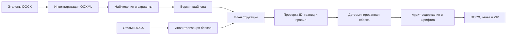

# Web 017: инвентаризация и восстановление исходников

## Назначение документа

Эта запись переносит в публичный репозиторий техническую карту работы, выполненной в отдельной рабочей среде 16 октября 2026 года. Её исходники и результаты не были отправлены в GitHub. Текущая ветка `main` содержит CLI 0.7, поэтому **описание ниже не является исполняемым кодом текущего checkout**. Полученный от владельца релиз следует сверить с этой картой и повторно проверить перед развёртыванием. Сама карта не заменяет проверку содержимого архива.

Известный публичный commit до добавления этой карты: `c776583e96936dd0a4218e3968b05ba7c07a6b76`. На тот момент в репозитории была одна ветка `main`; файлы `web017.py`, `structure017.py`, `scripts/install-web017.sh` в ней отсутствовали. Предыдущая локальная рабочая папка была заменена новой средой. Не копировать из неё воображаемые файлы и не объявлять исчезнувшие артефакты доступными.

## Цель Web 017

Пользователь загружает один или несколько правильно оформленных DOCX, подтверждает найденные варианты оформления, затем загружает до нескольких сотен статей. Система определяет смысловые части, переносит **существующие** фрагменты в заданный порядок, сохраняет научный текст и объекты, применяет профиль оформления. Если обязательных сведений нет, итог остаётся черновиком с заметным заполнителем и перечнем вопросов. Редакционные заметки выводятся отдельно. Заказанное направление — малая модель для назначения ролей при массовой обработке; генерация научных фактов моделью запрещена.

## Слой структуры

В прежней локальной версии отдельный модуль `src/articleflow/structure017.py` дополнял, а не заменял portable-profile предыдущих серий. Шаблон хранил порядок **слотов** и привязку к профилю форматирования. Для эталона «Русского инженера» выделялись УДК, заголовок, авторы, организация, город, email, заголовок аннотации, четыре части аннотации (постановка, цель, результаты, практическая значимость), остаток аннотации для проверки, ключевые слова, основная часть и редакционные заметки. Заголовок основной части «Проблема и постановка» не должен автоматически попадать в слот постановки внутри аннотации.

Инвентаризация читала корневые OOXML-узлы абзацев и таблиц, их порядок, идентификаторы и хеши. Эвристика использовала явные русские подписи и контекст заголовков; при необходимости ограниченный одношаговый вызов OpenRouter предлагал роли и точные диапазоны. Ответ модели не был командой на исполнение: код проверял все ID, допустимые роли и диапазоны. Неопределённость оставалась вопросом редактору.

Для перестановки использовались целые исходные узлы. Простой текстовый абзац можно было разрезать по границам графем (`regex` `\X`) на непересекающиеся диапазоны. Абзацы со сложными полями, формулами, ссылками и объектами нельзя было произвольно резать. Таблицы, рисунки и подписи сохранялись вместе с научным содержанием и относительным порядком внутри основной части. Поля, комментарии, несколько секций и сложные несогласованные bookmarks либо блокировали преобразование, либо требовали отдельного review. Перед сборкой инвентаризация заново сравнивалась с фактическим исходным DOCX, чтобы план не подменил содержимое.

Выделенные подписи частей аннотации оформлялись отдельно от текста: в эталоне четыре подписи были жирными, но весь текст пункта от этого не становился жирным. Для отсутствующего обязательного слота добавлялся жёлтый `[ЗАПОЛНИТЬ: …]`, для неразобранного остатка аннотации — отдельная видимая пометка проверки. Такой документ нельзя было маркировать готовым. Пользовательские данные сохранялись с отдельным provenance; исходная редакционная строка могла быть вынесена в `editorial.docx` только явно. Сборка проверяла сохранность каждого исходного научного узла и других частей DOCX-пакета. Font audit решал, есть ли фактическая подмена Arial/Times New Roman.

## Предполагавшиеся публичные файлы релиза

| Путь в прежней локальной работе | Назначение | Статус в текущем GitHub `main` |
| --- | --- | --- |
| `src/articleflow/structure017.py` | Слоты, анализ, проверка плана, сборка и вопросы | Отсутствует |
| `src/articleflow/structure_model017.py` | Один ограниченный OpenRouter-вызов и проверка ответа | Отсутствует |
| `src/articleflow/web017.py` | FastAPI, SQLite, очередь, версии, HTTP API | Отсутствует |
| `src/articleflow/web_static017/` | HTML/CSS/JS редактора | Отсутствует |
| `scripts/install-web017.sh` | Установка сервиса на Ubuntu/Debian | Отсутствует |
| `scripts/enable-https017.sh` | Certbot, nginx, TLS и Basic Auth | Отсутствует |
| `scripts/package-web017.py` | Подготовка приватного релиза по allowlist | Отсутствует |
| `scripts/benchmark_structure017.py` | Синтетические перестановки порядка аннотации | Отсутствует |
| `scripts/check-web-dom017.cjs` | Проверка DOM с живым API | Отсутствует |
| `tests/test_structure017.py` | Инварианты преобразования DOCX | Отсутствует |
| `tests/test_structure_model017.py` | Имитированный транспорт LLM | Отсутствует |
| `tests/test_web017.py` | HTTP-интеграция, ревизии, пакетная очередь | Отсутствует |
| `docs/tech/structure-017.md`, `docs/tech/web-017.md` | Подробные локальные технические контракты | Отсутствуют |
| `docs/research/structure-017.md` | Журнал локального исследования | Отсутствует |
| `docs/product/scenarios/structure-web.feature` и steps | Исполняемые сценарии локального среза | Отсутствуют |

Не переносить вместе с ними `artifacts/`, `private-fixtures/`, настоящие DOCX, рабочий системный prompt, ключи, модельные логи, лицензионные шрифты или пользовательские данные. Папки `src`, `tests`, `scripts` и `docs` из архива всё равно требуют проверки файлов на секреты и цитаты исходных статей перед публикацией. Действующие старые модули CLI 0.7 сохранять; импортировать новые файлы как отдельный срез и фиксировать совместимость в `pyproject.toml` и `README.md`.

## HTTP и хранение, которые описывал прежний срез

В прежней локальной версии один экземпляр FastAPI работал на `127.0.0.1`, данные хранились в SQLite и приватной папке. Встроенный шаблон и новые шаблоны имели версии; результаты задания — неизменяемые ревизии. После аварийного перезапуска незавершённые задачи помечались прерванными и не повторяли платный вызов автоматически. Число файлов ограничивалось 200 в пакете, размер — 25 MiB на DOCX, число эталонов — 10. Это технические наблюдения по прошлой среде; их нужно подтвердить на восстановленном коде.

API-префикс предполагался `/api/v017`: конфигурация UI; список, создание и утверждение шаблонов; создание пакета; состояние задания; PATCH решений с номером ревизии; запуск сборки; скачивание исходника/черновика/готового результата/отчёта/редакторских заметок; ZIP-снимок пакета. Мутации требовали CSRF-токен. Источник и все прошлые ревизии сохранялись; устаревшая ревизия возвращала конфликт. Готовый файл не выдавался при незаполненных обязательных полях или неподтверждённом оформлении.

Эта архитектура предназначалась для одного владельца за TLS reverse proxy с отдельной HTTP Basic Auth. Здесь пока нет изоляции арендаторов, полноценного редактирования произвольной онтологии, распределённого воркера, retention-удаления и Word/PDF-предпросмотра в браузере. Не приписывать Web 017 будущие свойства из [архитектуры](architecture.md) и [продуктовой спецификации](../product/product.md).

## Порядок восстановления

1. Получить от владельца исходники/релиз; проверить хеш и состав. Если релиз недоступен, реализации Web 017 в GitHub нет: сначала восстановить код и пройти тесты по этой карте, [структурным требованиям](../product/structure-017.md) и старым контрактам.
2. Отделить публичные модули/тесты/документацию от приватного эталона, prompt, расходов и данных. Проверить diff на ключи и научный текст.
3. Сверить версии зависимостей, запустить существующие 0.7 тесты и восстановленные 017 тесты в новой среде. Синтетические benchmark-результаты не выдавать за проверку на невидимых конференционных статьях.
4. Только после этого выполнить [инструкцию развёртывания](deployment.md). Сначала проверить существующий web stack на сервере: инсталлятор не должен отключать чужие сервисы.

Подробные правила научной честности и статус прежних измерений — в [журнале восстановления исследования](../research/session-017-recovery.md).
